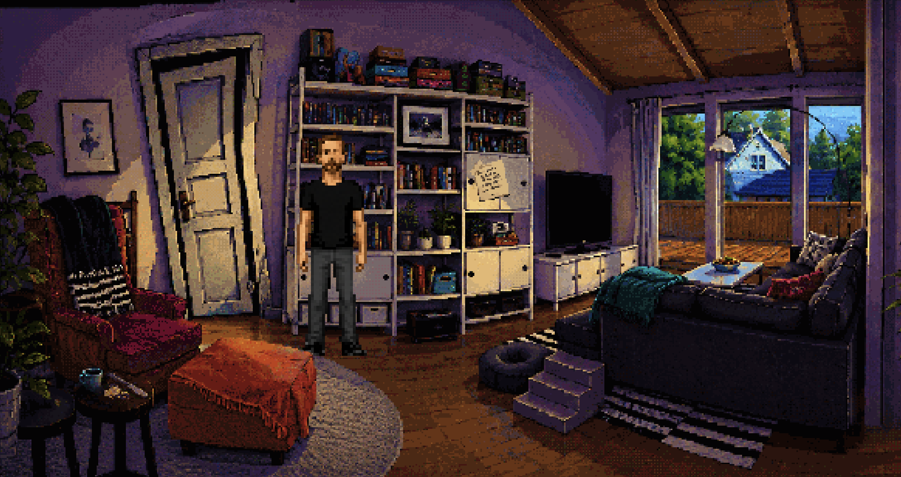
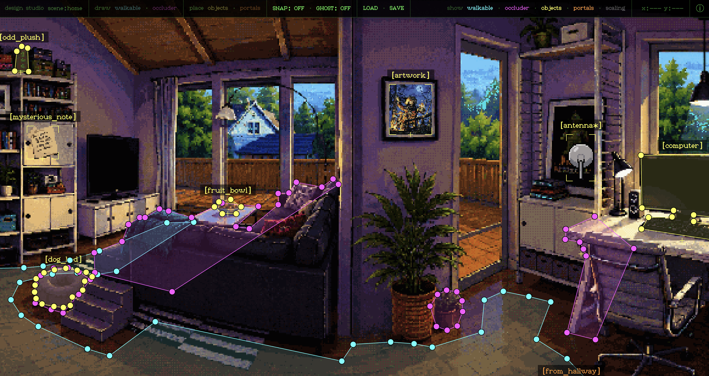

# Doodlejiggy



## What is Doodlejiggy™?

Doodlejiggy™ is a lightweight LucasArts-inspired point-and-click adventure engine focused on authored interaction, cinematic pacing, and low-friction scene scripting.

The name comes from:

- **DOODLE**  
  *Dynamic Object-Oriented Dialogue & Logic Engine*

powered by:

- **JIGGY™**  
  *Just Interactive Geometry, Graphics & Yokes*

DOODLE handles the authored scene layer:
- scenes
- objects
- actors
- dialogue
- interaction scripting
- inventory behavior

JIGGY™ provides the runtime systems behind Doodlejiggy™:
- rendering
- movement
- interaction geometry
- trigger execution
- scene state
- UI orchestration

The exact nature of the "Yokes" remains poorly documented.

See:
- `ARCHITECTURE.md` for design rationale, module structure, and engine invariants.
- `CONTRIBUTING.md` for code and documentation conventions.

## Project Structure

```
originals/          Source masters — managed via image/design/audio tools, never modified from code
src/                ES module source
  base.css          Global reset — linked by every HTML entry point
  engine/           The game engine — flat collection of modules
    schemas/        JSON Schema docs for the data files (validated at runtime + in-editor)
  tools/            Dev-only authoring tooling (debug overlay, Design Studio, MIDI Studio) — never built
public/             Static assets served at root (backdrops, sprites, inserts, interface, data, fonts, favicon)
screens/            README screenshots
index.html          Game entry
design.html         Design tool entry (development only; never included in production builds)
midi.html           MIDI Studio tool entry (development only; never included in production builds)
package.json
vite.config.js

.vscode/            Workspace settings — maps each data file to its JSON Schema (author-time validation)
```

## Development

First-time setup (once per checkout):

```bash
npm ci
```

This populates `node_modules/` from `package-lock.json`, which is committed. `node_modules/` is gitignored. CI installs the same way, so local and deployed builds resolve identical dependency versions.

Then to run the dev server:

```bash
npm run dev
```

- Game: `http://localhost:5173`
- Design tool: `http://localhost:5173/design.html`
- MIDI tool: `http://localhost:5173/midi.html`

Vite serves ES modules natively with hot reload. The entire `src/tools/` folder (the three tools plus the shared framework modules and `tools.css`) exists only in development and never enters the production build.

To verify the production bundle locally:

```bash
npm run build       # outputs dist/
npm run preview     # serves dist/ at http://localhost:4173
```

Note: `npm run preview` runs the production build, so `import.meta.env.DEV` is `false`: `debug.js` will not load and `localStorage` persistence is disabled. This matches the live deployment.

## Deployment

`dist/` is the production build (the game only, no dev tools): a static site to serve from a domain root (or set Vite's `base` for a subpath). This repo deploys to GitHub Pages via `.github/workflows/deploy.yml`.

## Core concepts

The engine's behavioral contracts, in dependency order.

### Scenes and coordinates

A scene is a room, declared by a single data file (`data/scenes/<name>.json`): its world, walkable areas, occluders, scaling lines, portals, object placements, triggers, scripts, and ambient barks. The `scenes` list in `game.json` is the authoritative set of scenes that make up the game.

The **world** is the scene's coordinate space. It is `CONFIG.world.height` pixels tall and as wide as the scene's `world` block declares. Artwork is optional: a world with no backdrop is a field of its clear color, which is how black transitions and epilogues are authored without a placeholder image. See **Authoring reference → `data/scenes/*.json`** for the block.

All authored coordinates are world pixels: the world's native resolution, independent of any backdrop's. The **origin point** of any positioned entity (actor, object, portal entry) is the bottom-center of its sprite (feet for actors, base for objects). All authored coordinates in scene JSON are origin points, and depth sorting uses this point.

The camera is horizontal-only: it scrolls over scenes wider than the viewport and follows the player by default (scripts can retarget or fix it; see **Script Actions → cameraFollow / moveCamera**).

### Entities: actors and objects

Both actors and objects are stateful world entities that share the same **state model** (`states`, `initialState`, and the state-setting actions). They also share synchronization actions such as `waitForAnimation` and `waitForState`. Neither is inherently sprite-backed: either may resolve without a sprite, and an object may be hotspot-only. Rendering and interaction are independent capabilities: a sprite controls only how an entity is drawn, and a hotspot controls only how an object is interacted with. Neither determines whether the entity exists or participates in state, ownership, or scripting. States are *not* what distinguishes the two types; the load-bearing difference is **behavior**. Their visual, animation, interaction, movement, and persistence contracts differ:

| Capability | Actor | Object |
|---|---|---|
| Moves / pathfinds | yes (`speed`, direction) | no |
| Traverses depth | yes (Y-scaled) | no (occupies depth) |
| Speaks (`say`) | yes (also dialogue / barks) | yes |
| Converses (dialogue, `talk`) | yes | no |
| Ownership / inventory | none | scene / player / none |
| Animation model | animation blocks (`idle`/`walk`/`talk`/`animations`), directional or non-directional | one flat strip per state |
| Hit area | sprite bounds | hotspot polygon, else sprite bounds |
| State persistence | opt-in per transition | always |

The one-line intuition: **objects *are* their state**; **actors *perform* states**.

An object's state defines what it is: a door is open, a light is on, an antenna is deployed. Change the state and you change what the object fundamentally is. Its appearance is always defined entirely by its current state.

An actor performs actions while remaining the same actor: it walks, idles, and speaks, and goes on being that actor throughout. This is why a temporary animation override makes sense for an actor. The override is temporary, and when it finishes the actor simply returns to whatever it is currently doing. An object has nothing to return to, which is why there is intentionally no object `playAnimation`. It is not a missing feature. An object has no activity independent of its current state.

Why they stay two distinct types rather than one is covered in `ARCHITECTURE.md` § Data model.

### Scene scaling and entity size

`height` is an entity's authored reference size in world pixels: its size at scale 1. Width always derives from the frame's natural aspect ratio; when `height` is absent, the sprite's natural single-frame pixel height is used. The design tool and debug overlays compute the same box the game renders, so what you place is what you get.

Scene scaling is authored per room as NEAR/FAR lines (Design Studio) and sizes entities by depth. The mental model is `height → base authored size → depth factor → final entity scale`. One resolution rule produces the final scale for any entity, and every scale-dependent subsystem reads it — render size, hit region, speech and scan-marker anchors, and walk pace — so they always agree. Actors participate by default: their depth factor resolves at their feet Y. Objects always render at their authored size. They occupy depth but do not traverse it, so scene scaling does not apply to them. An actor opts out with `scaling: "fixed"`: it no longer participates in the room's scaling curve (constant size and uniform walk pace), the way objects always behave. It still depth-sorts, occludes, and holds its Y like any other entity; only scaling is disabled.

### Render planes

The optional `plane` field puts an entity on one of three rendering planes; absent = `normal`. It's a single axis, so the behaviors are mutually exclusive by construction: no accumulating flags (`flat` + ignore-occluders), no representable contradictions.

- `normal`: upright entities standing on the floor. Y-sorts with everything and is clipped by occluders. The default; for actors and props the player walks around (a stone, a barrel) where y-sort gives correct front/behind occlusion.
- `flat`: floor-level entities with no meaningful vertical extent (shadows, puddles of light, decals, worms/slugs). Draws before every non-`flat` entity regardless of y, so an entity at a similar y doesn't flicker through it as their sort keys cross; still clipped by occluders. `flat` entities y-sort among themselves.
- `surface`: entities resting on raised scenery (tables, shelves, desks). Y-sorts normally but **skips** occluder clipping, so an actor or object placed on furniture that sits inside a walk-behind region isn't swallowed by it.

`plane` applies to both actors and objects and is state-resolvable for either entity type (for example, an object that breaks into rubble switching `normal`→`flat`, or an actor moving onto a `surface` plane in a presentation state). Foreground occlusion itself (an entity passing behind background scenery) is defined by scene-level occluder polygons; `surface` is simply how an entity opts out of that clipping.

### Flag conditions

Flags are global booleans set and cleared by scripts (`setFlag` / `clearFlag`) and dialogue topics; they persist in the save. **`if` / `ifNot`** form the engine-wide condition vocabulary over them, evaluated identically everywhere it appears: scene triggers, dialogue topics, portal exits and their `blocked` clause, object placements, and ambient bark variants. Each is a single flag name or an array of names. `if` passes when *every* listed flag is set; `ifNot` passes when *none* are (any one set fails it). When both are present both must pass; a node with neither is unconditional. An empty array is rejected at load time rather than treated as a silent no-op.

```json
{ "if": "door_opened" } // single flag
{ "if": ["fuse_set", "power_on"] } // AND — all required
{ "ifNot": ["alarm_armed", "guard_awake"] } // forbidden — none may be set
{ "if": ["has_key"], "ifNot": ["door_broken"] } // both requirements apply
```

### Interaction model

Hover and click or tap resolve their target through one question: which interactable would the player perceive as on top at this point? Actors and objects y-sort into a single shared draw order, and interaction walks the same order, so what draws on top is exactly what a hover or click resolves to. Portal exits (see **Portals**, next) are the highest-priority category, queried first, so a doorway beats a sprite that overlaps it. Below them, the frontmost actor or object in the shared draw order wins, so interaction priority matches what the renderer paints on top rather than favoring one kind over the other. The player and inert `interaction: "none"` entities are excluded. Each kind keeps its own hit area (actors test against sprite bounds, objects against their polygon hotspot or authored bounds); only the cross-kind ordering is shared. Objects, actors, and exits are not distinguished by cursor (see **Hover** below). On a click or tap, it routes:

| Click target | Routing |
|---|---|
| Empty walkable area | Plain walk |
| Scene object | Interaction dispatch — verb resolved on arrival |
| Scene actor | Interaction dispatch — verb resolved on arrival |
| Inventory icon | Always look — the item's `interaction` field is ignored |
| Inventory drag-and-drop on target | Use-on dispatch — target is either an object or actor |

**Portal exits and entries are not use-on targets, by design.** They are pure navigation primitives: an exit's only verb is "traverse" (click → walk + `changeScene` or fire `blocked.message`), an entry has no verbs at all. The drag-drop hit-test resolves through the same topmost-interactable pick, which covers only objects and actors; dropping an inventory item on an exit resolves as "drop on nothing" (silent cancel, no `useObjectOnExit` trigger exists). Authors who want a key-on-door interaction model the door as an *object*; the portal exit, if any, stays layered separately as the navigation primitive.

The entity's resolved `interaction` value selects one of four dispatch paths (`look`, `pickup`, `use`, `talk`). Pending walk-then-interact state is cancelled the moment the scene hides, so a mid-walk transition can never carry an interaction into the next scene.

**Re-resolution on arrival.** When the player clicks an entity to interact, the walk to it is captured but the verb is **not**. On arrival, the engine reads the current `interaction` value from the live instance. A script that mutates an object's state mid-walk (changing its `interaction` from `pickup` to `use`, say) results in the new verb firing. This is deliberate: the engine reacts to current state, not stale click-time state.

**Engage — pre-resolution interception.** Arrival is itself a public lifecycle stage. The moment the player reaches any interaction target (object, actor, or portal exit), the scene's `engage` trigger fires: after the approach, before the engine resolves what the interaction means. If one or more `engage` triggers match, they replace the interaction — the engine performs none of the resolution below (no verb dispatch, no use-on dispatch, no exit traversal, and no `blocked` evaluation). If none match, resolution proceeds normally. This holds regardless of how the interaction was initiated: a direct click and an inventory drop both engage their target on arrival. Inventory icon look has no approach phase and never engages. See the **Triggers** reference under `data/scenes/*.json` for authoring guidance and examples.

Dispatch summary (the resolution stage):

| Resolved verb | Engine action | Trigger fired | Fallback (if no trigger handled) |
|---|---|---|---|
| `look` | Speak `description` (descIndex bumps); apply `transitions.look` if any | `objectLook` / `actorLook` | none (silent if no description) |
| `pickup` | On object: transfer ownership via `giveObject`; speak `pickupText` if any; apply `transitions.pickup` if any. On actor: rejected. | `objectPickup` (object only) | `fallbacks.pickup` (actor only) |
| `use` | None | `objectUse` / `actorUse` | `fallbacks.use` |
| `talk` | Start the actor's `dialogue` (topic-based dialogue mode), or speak its `talkText` line(s). See **Dialogue system**. | none | none. A talkable actor with neither is an authoring error (validator warns); there is no `talk` fallback |

`look` arrays advance one entry per look and repeat the final entry indefinitely. `descIndex` resets to `0` whenever `setObjectState` changes the object's state. Actor look-array progression is monotonic: `setActorState` does not reset it.

**Validation.** The `interaction` field is constrained to the four canonical verbs by the actor/object JSON Schemas (`interaction: { enum: [...] }`, top-level and per-object-state). A typo like `"pickkup"` warns at load with the allowed values listed. Unknown values are never rejected at runtime; they fall through to the look fallback.

**Hover and scan** share the same overlay render pass (after y-sort, before speech). Interaction modes are intentionally separated:

- **Hover**: no canvas affordance drawn. The hovered entity is routed to the verb line — scene objects, actors with a `title`, and portal exits alike. The line reads as an action: the `messages.templates` entry for the entity's current interaction verb (`look` / `pickup` / `use` / `talk`, or `portalExit` for exits) is filled with the title as `{target}`. Every hoverable switches to one shared hover cursor, the theme's `cursorHover` (see **`data/game.json`**): the cursor signals only that something is actionable, and identification is via the verb line. The clickable UI carries the same cursor, so an inventory item or a dialogue topic reads as actionable exactly like an entity in the scene. A game that themes no cursor keeps the browser's own throughout, and the verb line is the whole affordance.
- **Scan (Shift held)**: scan draws a marker at the visual centre of each interactable: sprite objects use the sprite's screen-rect centre, while polygon-only hotspots use the bounding-box centre. The marker is a small white dot with a black outline unless the game supplies its own artwork (`theme.interface.scanMarker`). Coverage includes objects, non-player actors, and portal exits that currently exist (existence-gated exits show no marker, matching their absence from hit-testing; the polygon-hotspot path otherwise handles exits transparently, so they look the same as a hotspot-only object). Inert `interaction: "none"` entities are excluded, matching their absence from hit-testing. Presentation is identical across all three, so the player sees one uniform affordance class with no engine-geometry leakage. Markers are viewport-gated: entities outside the current camera frame are suppressed.

### Portals

**Portals** group two related navigation primitives under one `portals` map: `entries` (where actors arrive) and `exits` (click-to-traverse polygons that send the player to another scene + entry). Both are managed in Design Studio via a single **portals** toolbar button (Entry / Exit picker); JSON-only fields (title, destination, blocked, facing, walk) are added by hand and round-tripped through the design tool.

**Entries** are named origin points where actors can spawn or arrive (see **Scenes and coordinates**). An optional `facing` field sets the direction the actor faces on arrival, defaulting to `south`. An optional `walk` field gives a cardinal direction (`"north"` / `"south"` / `"east"` / `"west"`) that triggers a *portal walk-in*: the spawning actor starts offscreen on the side opposite the walk direction and walks in toward the entry on a single straight-line waypoint, with pathfinding bypassed. Camera centers on the entry (not the offscreen actor) and stays frozen until the walk-in completes or the player takes control. Without `walk`, the actor spawns directly at the entry point. `facing` is independent of `walk`: if both are set, `facing` is the post-arrival pose; if only `walk` is set, the actor finishes facing the direction they walked in.

```json
"portals": {
  "entries": {
    "start": { "x": 216, "y": 231 },
    "from_chamber": { "x": 420, "y": 180, "facing": "east" },
    "from_hallway": { "x": 560, "y": 250, "facing": "north", "walk": "north" }
  },
  "exits": {}
}
```

**Exits** are polygon hotspots that transport the player to a destination scene + entry on click. Invisible in-game (no sprite, no graphics: they're navigation primitives, not world entities). Hotspot points are stored as **absolute scene coordinates** (unlike object hotspots, which are origin-relative: exits have no separate origin):

```json
"portals": {
  "exits": {
    "to_hallway": {
      "title": "Hallway",
      "hotspot": [[0, 80], [40, 80], [40, 260], [0, 260]],
      "destination": { "scene": "hallway", "entry": "from_home" }
    }
  }
}
```

`title` shows in the hover verb-line. `destination.scene` may reference the current scene: this triggers a full scene reload at the named entry. Useful for resetting a room's dynamic state via a doorway.

Optional `walk` field on an exit mirrors the entry's `walk`: same cardinal-direction values (`"north"` / `"south"` / `"east"` / `"west"`). When set, the player walks to the exit's interact point, then continues in the given direction on a single straight-line waypoint targeted at scene-edge + actor-size; the camera is frozen so the actor visibly leaves the frame. The scene transitions the moment the actor's bounding box clears the *visible viewport edge*; the scene-edge waypoint is a safety cap, not the intended termination point (this keeps the cut snappy on small/non-scrolling scenes rather than waiting for a long walk past the scene boundary). Pathfinding is bypassed during the walk-off. Without `walk`, the transition fires the moment the player reaches the exit's interact point, appropriate for door/archway exits where stepping into the hotspot *is* the exit. Side-edge exits (hallways, corridors) typically want `walk` set toward the edge so the player sees the actor leave.

```json
"hallway": {
  "title": "Hallway",
  "destination": { "scene": "corridor", "entry": "from_room" },
  "walk": "west",
  "hotspot": [[0, 80], [40, 80], [40, 260], [0, 260]]
}
```

**Existence vs blocked: two independent gates.** An exit has two distinct conditional axes, captured by two separate predicates; keep them straight:

- **`if` / `ifNot` (top-level): existence.** When the condition fails the exit is *absent*: no hover, no scan marker, no click target. Existence is one predicate, honored uniformly by hover, scan markers, and clicks. Same `if`/`ifNot` semantics as everywhere else (see **Flag conditions**). Use for routes that only *appear* after progress, e.g. a doorway gated `if: door_opened`, so the closed door is handled by the door *object* and the exit materializes only once open.
- **`blocked`: visible but refused.** The exit exists and hovers normally, but traversal is refused with a message. Use for known routes the player can't pass yet (locked gate, guard).

Precedence: existence wins. A non-existent exit is never hit-tested, so its `blocked` clause never evaluates.

```json
"to_chamber": {
  "title": "Back Room",
  "if": "door_opened",
  "hotspot": [[100, 40], [125, 205], [168, 204], [156, 104], [160, 33]],
  "destination": { "scene": "chamber", "entry": "from_home" }
}
```

Optional `blocked` clause makes traversal conditional. If `blocked.if`/`blocked.ifNot` matches at click time, the player walks to the exit, then `say`s a line from `blocked.message` instead of transitioning. `blocked.message` is itself optional; if absent, the engine falls through to the `messages.fallbacks.portalBlocked` array in `game.json`. Same `if`/`ifNot` semantics as everywhere else (`if` = blocked when flag set, `ifNot` = blocked when flag unset). `blocked` is part of exit *resolution*: a matching `engage` trigger fires first and replaces the entire resolution, including the `blocked` check (see **Interaction model**). `blocked` remains the declarative convenience for the common refuse-with-message case; anything behavioral belongs in an `engage` trigger, and `blocked` stays message-only by design:

```json
"to_hallway": {
  "title": "Hallway",
  "hotspot": [[0, 80], [40, 80], [40, 260], [0, 260]],
  "destination": { "scene": "hallway", "entry": "from_home" },
  "blocked": {
    "if": "hallway_locked",
    "message": ["The hallway door won't budge.", "Locked."]
  }
}
```

**Click priority.** Portal exits hit-test first: they beat objects and actors at the same screen position (see **Interaction model**). Entries are pure engine geometry: not hoverable, not clickable in-game.

**Walk target.** Clicking anywhere inside an exit polygon resolves to a single canonical walk destination (bottom-center of polygon bounds), mirroring how object hotspots resolve their walk target. Large exits don't produce drift-prone walks.

**Cursor.** Exits hover like any other interactable (see **Hover and scan**). There is no exit-specific or directional glyph; the verb line (e.g. "Walk to Hallway", from the `templates.portalExit` phrasing) carries the scene-change affordance instead.

**Input lock during portal walks.** While the player is mid walk-in (entry `walk`) or mid walk-off (exit `walk`), input is gated: clicks, hover updates, and inventory drags are all suppressed. The engine has committed to a scripted straight-line traversal with a frozen camera; letting the player interrupt would leave a walk-off pending without ever firing the transition, or cancel the camera-freeze mid-arrival. Same effect as a running cutscene, but driven by the actor's portal-walk state rather than the script lock. Cutscene scripts defer their start while the player is mid portal walk, so a cutscene cannot collide with the player's traversal.

### Actor lifecycle

Actor definitions are loaded once and never modified. Live actors are scene-local: every scene load starts empty, and instances (position, path, frame) exist only while their scene is active.

**Player identity and player instance are separate concepts.** The configured player identity (`game.json` `player`) says which authored actor is the player. The live player instance exists only while that actor is spawned in the active scene, and may be absent (for example, removed by a script for a cutscene). Inventory, object ownership, and save progression are keyed by the identity, so they survive despawn, respawn, and reload. Runtime simulation (movement, interaction, speech, animation, following) operates on the live instance and requires one to exist.

**Actor creation has a single path.** Whether the engine spawns the player on scene entry or a script spawns an NPC, the same rules apply. Placement is **either** a named entry **or** explicit coords:

- If `entry` resolves to an existing entry in the current scene → that entry's position is used; `facing` (if provided) overrides the entry's `facing`. If the entry has a `walk` direction, the actor performs a portal walk-in instead of spawning in place (see **Portals**).
- Else if both `x` and `y` are numbers → those coords are used; `facing` defaults to `south` if not given.
- Else → `console.warn` and no spawn.

This is the only documented way to create an actor; the script-action description below is just a thin pointer to this rule.

Entry-based spawns fire two triggers: **`actorEnter`** (registered to the scene) then **`actorArrive`** (standing at the entry); coord-only spawns fire neither. See the trigger event reference under **`data/scenes/*.json`** for exact timing and how to use each.

**Actor removal is the corresponding destruction path**, with or without a portal exit. Without an exit, the actor is removed immediately and any actor following it is unlinked. With an exit, the actor walks to the exit's interact point, runs the walk-off if the exit has a `walk` direction, then despawns; the exit form blocks the calling script until the despawn completes. The polymorphism is symmetric with creation's entry/coords split: with-portal vs without-portal.

The exit's `blocked` clause is **not** evaluated for scripted `removeActor`: `blocked.message` is player-facing UX, not a gate the engine enforces on author-driven movement. The player's own exit click still honors `blocked`.

Exit-based despawns fire the **`actorExit`** trigger just before the actor is removed; instant despawns (no `exitName`) do not. See the trigger event reference under **`data/scenes/*.json`**.

Removing the configured player actor is a fully supported workflow (for example, a player-less cutscene). Only the live runtime instance is removed; progression state (inventory, object ownership, save data) stays intact until the actor is spawned again.

Actor `height` is optional; it falls back to natural single-frame height (see **Scene scaling and entity size**).

Actors support **states**: the same swappable appearance/behavior machine objects have (see **Entities: actors and objects**). A state overrides only the fields it declares; everything it omits stays at the actor-level value. A state may change the sprite sheet, the animation blocks (`walk`/`idle`/`talk`/`animations`), and behavior fields (`interaction`, `description`, `dialogue`, `talkText`, `speechColor`, `speechEffect`, `speechOffsetX`/`speechOffsetY`, `offsetX`/`offsetY`, `height`). Once those are applied, the resulting sprite and animation fields determine the actor's appearance. `setActorState(name, state, persist?)` swaps states: the state's fields re-resolve onto the live instance, the sprite-sheet frame size recomputes, and the sprite resizes while **preserving the feet-center** so a differently-sized sheet grows in place. Runtime state (position, facing, path, follow) is never touched; only authored fields are re-resolved.

Unlike objects, actor-state persistence is **opt-in per transition** (`persist`, default `false`): a transient presentation state (a one-off cutscene pose) lives only on the instance and reverts to the saved baseline on the next rebuild (scene re-entry, reload); `persist: true` writes `save.actors[name].state` for durable progression. So the live instance state is the render truth, while the save holds the progression baseline. See **`data/actors.json` → States**.

### Object lifecycle

Object definitions are loaded once and never modified. Live objects are scene-local: every scene load starts empty and spawns the scene's placements; an instance carries its position, dimensions, current frame, and the current state's resolved fields.

**Objects are globally unique.** Each object key has one runtime identity across all scenes. There are no prefab instances; the same object cannot appear in two scenes simultaneously. (See **Object ownership** for the persistence rule that enforces this.)

**Object creation has a single path**, fed by two placement sources at scene load:

1. **Static placements** from the scene JSON's `objects` map (declarative authoring).
2. **Dynamic placements** from save state: objects placed at runtime by a persistent `spawnObject` (`persist: true`). A `persist: false` spawn creates only a live runtime instance and is never restored on scene load.

The two merge before spawning: if a name appears in both, the dynamic placement supersedes the static entirely, so an item dropped at a new spot doesn't snap back to its declared coords. Declared and spawned are distinct sets — a declared placement may not spawn (owner moved elsewhere, condition failed) — and diagnostics show the declared set, so non-spawned placements stay visible in the debug overlay.

Ownership gates spawning: a placement is skipped when the object has been moved out of this scene (picked up, consumed, relocated; see **Object ownership**). The placement's `if` / `ifNot` flag conditions are then evaluated. A spawned instance starts in its saved state, or its definition's `initialState`.

**Conditional placements are evaluated once at scene load.** If a placement is gated by `if: "some_flag"` and that flag becomes true later in the same scene, the object does **not** retro-spawn; re-enter the scene or use the `spawnObject` script action to place it explicitly.

**Sprites are preloaded at scene load.** Before the fade-in begins, the engine gathers every sprite the scene immediately references — all state sprites of placed objects, the player actor's sprites, sprites the scene's scripts bring in via spawn-style actions, and currently owned inventory icons — and waits for them to decode. Spawning happens after that, so every entity is born sprite-complete, and in-scene state changes reuse the already-decoded image, so a sprite swap never shows a decode gap. The inventory strip's authoritative first render happens at this same point, after the preload resolves: icons slice a single frame from a decoded sheet (see **Icon fallthrough**), and inventory sprites are in the preload set, so the strip never builds from an undecoded image. (What is and isn't chased into the preload set is defined in `ARCHITECTURE.md` § Sprite preloading.)

Object `height` is optional; it falls back to natural single-frame height (see **Scene scaling and entity size**).

Three script actions mutate objects beyond state transitions — `spawnObject`, `giveObject`, `removeObject`; each action's contract lives under **Script Actions**. All three refresh the inventory strip after mutating, so contents and labels stay current, and player pickup routes through the same path as `giveObject`, so scripted and player-driven changes behave identically (see **Inventory**).

#### Object ownership

Object ownership is persistent progression state. **An object has exactly one owner at any time:**

- a scene name → the object lives in that scene's `objects` map (declared statically or placed dynamically)
- the player actor's name (`game.json` `player`) → the object is in the player's inventory
- `null` → the object has been destroyed / consumed and no longer exists in the game world

Never two of these. Inventory ownership is *not* a separate state from scene ownership; it replaces it. This is the mechanism that prevents already-collected items from respawning into a scene when the player re-enters: `spawnObject` skips placement when the saved owner doesn't match the current scene.

Default ownership is implicit. An object placed in a scene's `objects` map belongs to that scene until something moves it; only entries that diverge from default are written to `save.objects`. Adding new objects to a game never invalidates older saves.

#### Object state machine

The save also stores per-object current state; like ownership it's sparse: when absent, the engine treats the object as being in its `initialState`. The pair (owner, state) is the full persistent identity of an object across scenes and reloads.

Every state change passes through one consistent path: the new state persists immediately; a live instance re-resolves its fields (title / description / interaction / transitions / animation) and syncs its sprite — loading the new image if the filename changed, or clearing the sprite and dropping to zero visual dimensions if the state declares no sprite; and the inventory strip refreshes, since a state change can alter a visible item's icon or label.

Both routes into a state change take this path: the `setObjectState` script action, and the engine-applied `transitions.look` / `transitions.pickup` targets. A one-shot animation completing is not itself a transition trigger; scripts observe completion explicitly via the `waitForAnimation` action (see **Script Actions**), which works for objects and actors alike.

Field resolution works with or without a live instance: an inventory item (which has no instance) resolves exactly as a placed one would, and both views refresh through the same state-change path, so they cannot diverge.

### Inventory

The inventory is **a query over object ownership**, not a separate data structure. Every object whose `owner` is the configured player actor (`game.json` `player`) is in the inventory. There is no inventory list to keep in sync; ownership is the source of truth, and the visible strip is derived from it. This is why the player-pickup flow and the `giveObject` script action share the same code path: both ultimately set `owner` to the player actor, and the strip re-renders from ownership.

Ownership is keyed by the configured player identity, not the live player instance, so the ownership operations (`giveObject`, `removeObject`) work even while the player actor is not currently spawned: scripts may freely give, transfer, or destroy items during a player-less cutscene. Inventory is progression state, not runtime simulation; it survives despawn, respawn, and reload. This is intentional (see **Actor lifecycle**, player identity vs. instance).

**The strip.** The inventory is a thin strip along the bottom edge of the screen, showing the player's items as a row of clickable icons (64×64 on desktop, 36×36 on touch devices). There is no toggle button and no panel: the strip *is* the inventory.

**Visibility** is derived from ownership like everything else about the strip, never stored: it is shown whenever the player holds at least one item and hidden otherwise. So it appears on the first pickup (no chrome before the player has any reason for one), hides again if the inventory empties because an item was consumed or removed, and returns the moment a new item appears.

**Click-through:** the strip background uses `pointer-events: none`; only the item tiles themselves capture clicks. The empty area around items remains clickable as game canvas (walk, look, pickup), with no input dead-zone introduced by the strip itself.

**Interactions per item tile (desktop and mobile via Pointer Events):**

| Gesture | Effect |
|---------|--------|
| Hover (desktop) / press-down (mobile) | The item's `title` appears in the **verb line** (a small label floating just above the strip). Mobile substitutes press-down for hover since touch has no hover state. |
| Click / tap (no movement) | Always look: the player speaks the item's `description`, any `transitions.look` runs, and the `objectLook` scene trigger fires. The item's `interaction` field is ignored. |
| Click + drag past ~5px | Drag-to-combine begins. A translucent ghost icon follows the pointer, and the verb line becomes "Use *source* on *target*", with *target* updating live to whatever scene object or actor is under the pointer. |
| Drop on a target | Walks the player to the target, then fires `useObjectOnObject` or `useObjectOnActor` (per target kind). If no trigger matches, the player speaks a random `messages.fallbacks.useOnObject` / `messages.fallbacks.useOnActor` line. |
| Drop on nothing | Cancelled silently. |

**Verb line** is a single shared HTML element above the strip. It fades in on hover/press, transitions cleanly into the drag readout, and fades out on release. Its typography is `theme.verb` (see **`data/game.json`**), which defaults to the same size ratio as the speech bubble.

**Focus lock.** The strip dims and becomes fully non-interactive whenever the engine is mid-beat: a script-owned line is on screen, a cutscene is running (or about to begin), or the player is in a portal walk (the interaction lock). Hovering produces no labels; clicks and drags are silently ignored. Any in-flight drag is cancelled the moment focus shifts. The strip returns to full opacity and interactivity as soon as the engaged interaction ends. Ambient barks deliberately do **not** trip focus lock; the world stays interactive while NPCs mutter.

### Dialogue system

**Speech vs. dialogue vs. talk.** Four distinct concepts, each with a single responsibility:

- **speech** — the presentation subsystem for spoken lines (rendering, timing, color, effects, positioning, blocking): one shared pipeline fed by the `say` / `sayRandom` actions, dialogue playback, and ambient barks. An utterance of exactly `"..."` renders as a normal bubble but does not drive the speaker's `talk` animation.
- **say** — the primary script action that produces speech; `sayRandom` is its random-line sibling (see **Script Actions → say**).
- **dialogue** — the conversation system layered above speech: topics, conversation playback, progression.
- **talk** — the interaction affordance that opens a conversation (`interaction: "talk"`, the `talkTo` action, `talkText`), plus the actor `talk` animation played while a line is spoken.

The boundary: **any world entity can speak (actors and objects alike), but only actors converse.** A terminal or sign can `say` a line in its own `speechColor`; `dialogue` / `talkText` / `interaction: "talk"` stay actor-only.

**Speech effects.** A spoken line may carry a presentation effect that animates the bubble while it shows. `jitter` is a small, fast instability for glitchy or malfunctioning voices; `shake` is a larger, more forceful motion for impacts and loud noises (`*CLUNK*`, `*BANG*`); `crt` is a near-still digital effect for terminals, monitors, and synthetic voices, a sub-pixel horizontal warp under a faint brightness flicker, felt more than seen; `wobble` is a stronger, slower version of that warp, an overtly rippling distortion. Effects are presentation only: they never change speech timing, animation playback, or script behavior. Resolution is nearest-override-wins: any authored speech unit (a `say`/`sayRandom` step, a dialogue line, an ambient-bark variant) may specify an optional `effect`; otherwise the speaker's `speechEffect` (`actors.json` / `objects.json`, state-resolvable) is used. Plain-string speech fields (`talkText`, `pickupText`, `blocked.message`, `messages.fallbacks.*`) always inherit the speaker's `speechEffect`.

Topic-based conversations (LucasArts-style): the player picks from a list of topics, each plays an authored exchange and applies lightweight consequences, then the list recomputes. **Not** a branching dialogue tree. *Dialogue progression is world progression*.

**Talk dispatch.** The `talk` verb resolves an actor's response: an actor with a `dialogue` opens dialogue mode; an actor with `talkText` speaks directly (a string or array desugars into N `say` steps); neither is an authoring error.

**Runtime model.** Click-to-talk and the scripted `talkTo` action share one entry point: both resolve the actor's current dialogue (the state-resolved `dialogue` field, else the def's default) and open it. The greeting plays once per actor+dialogue (`greeted`), then the topic list shows. A topic is visible if it isn't removed, its `if`/`ifNot` flag conditions pass (see **Flag conditions**), and it is either a **root** (not targeted by any `unlockTopics`/`replaceWith`) or has been unlocked. Selecting a topic hides the list, plays its `conversation` beats through the speech pipeline, then applies consequences and recomputes. Consequences commit as one unit: the topic-graph mutations (`unlockTopics`, `replaceWith` = remove source + unlock target, `removeAfter`) apply first, then `setFlag` last, so any `flagSet` trigger it fires observes the fully-committed post-topic state rather than a partial one. Beat playback inserts a silent breather of `config.speech.speakerGapMs` between consecutive beats when the speaker changes (same-speaker runs stay tight); the gap only plays when a line ends on its own; skipping (`Space`/click) jumps straight to the next beat and discards any pending gap. Dialogue exits on an `endDialogue` topic or when no visible topics remain. Active dialogue is scene-local transient: force-closed on `changeScene`; only progression persists.

**Cutscenes from dialogue.** A topic that sets a flag can drive a cutscene through a `flagSet` trigger, and this presents cleanly from a **dialogue-ending topic**: the trigger starts the cutscene, the dialogue closes, and the cutscene then plays in full. Do **not** launch a cutscene from a **mid-conversation topic** (one that returns to the topic list): its non-blocking actions execute immediately while the conversation is still active, and its blocking presentation waits until the conversation ends, so it splits across the conversation boundary. Interrupting a conversation to play a cutscene and then resuming it is not currently supported.

Dialogue lines count as owned speech: they suppress ambient barks and gate input the same way scripted lines do, for the whole conversation — including the topic-selection gaps between lines.

**UI.** The numbered, clickable topic list is screen-space UI, selectable by click or number key, and typeset from `theme.topics` (see **`data/game.json`**). Spoken lines use the normal canvas speech bubble. The inventory is hidden during dialogue mode.

### Script execution model

**Concurrent scripts.** Multiple scripts run in parallel: each has its own execution state and ticks independently every frame. All matching triggers for a given event fire simultaneously, each as its own script. Scripts are identified by their key in the scene's `scripts` map. Starting the same script while it is already running restarts it from the beginning.

**Script states.** A running script ticks its steps each frame. A cutscene script can additionally be **pending**: registered but not yet executing because the world isn't idle. Pending cutscenes do not count as input-blocking; they're queued intent that hasn't claimed control yet.

**`cutscene: true`** marks a script as a cutscene. The flag bundles four behaviors:

1. **Defer until idle.** The script starts pending and stays pending while the interaction lock is held (speech or dialogue mode on screen, another cutscene running, the player mid portal walk-in/walk-off), then transitions to running and begins executing steps.
2. **Cancel player intent on start.** At the pending → running transition, the player's `path`, `followTarget`, and animation override are cleared and any pending click-then-interact is dropped. Other actors are untouched: their state was set by scripts, not user intent, and the cutscene retargets NPCs explicitly via `walkTo` / `follow` / `unfollow` if it wants.
3. **Block clicks while running.** Clicks to walk, clicks on objects/actors, and clicks on inventory icons are all silently ignored. Hover remains active (it grants no control). One engine-defined exception: a script blocked on `waitForInput` consumes the next deliberate input even inside a cutscene (see **`waitForInput`**).
4. **Serialise.** Two cutscenes pending in the same tick run one after the other in registration order. Once the first transitions to running, the second's idle check sees it and stays pending until the first finishes.

The portal-walk window is sacrosanct: a cutscene defers until the player's portal walk completes and never cancels it.

Defaults to `false`. Non-cutscene scripts (the default) run immediately and concurrently like any other script.

**Speech lock.** `say` (and `sayRandom`) is globally serialised: only one script can be in a blocking speech step at a time. When a concurrent script reaches a speech step while another script is already speaking, it waits (the step doesn't fire until the lock frees), then speaks on the next available tick. Order is determined by trigger declaration order: within one event burst, earlier-listed triggers acquire the lock first.

This makes "play a generic line after an item-specific line" trivially expressible: declare the specific trigger first, the catch-all (`ifNot`-gated) second, and the dialogue plays sequentially:

```json
"triggers": [
  { "on": "objectPickup", "object": "mysterious_note", "run": "comment_on_note" },
  { "on": "objectPickup", "ifNot": "intro_pickup_said", "run": "first_pickup_intro" }
]
```

Skip-click (`Space`) advances the currently-speaking line; the next queued line fires on the following tick. Each `say` is time-bounded — a minimum display time plus a per-word duration (tuned in `config.js`) — so the lock always releases on its own (no risk of hang).

**stopScript and visible speech.** When a script is stopped (either by name or via `stopScript()` with no name), any on-screen spoken line *that script opened* is cleared in lockstep. Lines opened by other scripts are untouched. Engine-initiated speech (`look` descriptions, fallback lines, ambient barks) has no script owner and is never cleared by `stopScript`, only by its own timer or by `changeScene`.

**changeScene safety.** `changeScene` calls `stopScript()` (clears all) and `clearSpeech()` before loading the new scene. A `cutscene: true` script that runs `changeScene` cannot leave the game soft-locked: the input block dies with the scripts on the way out. Pending cutscenes are wiped the same way.

### Save system

Progress is saved automatically to `localStorage` under the key `dj`, but only in dev builds; production never touches localStorage (gated on `import.meta.env.DEV`). The save contains:

- `scene`: current scene name
- `entry`: entry point used to arrive at the current scene
- `flags`: set of active flags
- `objects`: per-object overrides for ownership, state, position, and description-sequence progress. Only entries that have diverged from defaults appear here. Examples:
  - `{ "welcome_note": { "owner": "ego", "state": "read" } }`: a static placement that was picked up and read.
  - `{ "apple": { "owner": "home", "x": 240, "y": 180 } }`: a dynamic placement created at runtime (`spawnObject` script action) that lives in the `home` scene at coords (240, 180).
  - `{ "manual": { "owner": "home", "descIndex": 2 } }`: an object still in the world whose array `description` sequence has advanced twice. `descIndex` resets to 0 whenever `setObjectState` changes the object's state.
- `actors`: per-actor overrides for persisted state and description-sequence progress (`{ state, descIndex }`). `state` appears only when a `setActorState` with `persist: true` diverged the actor from its def's `initialState` (transient presentation states never reach the save; see **Actor lifecycle**). `descIndex` tracks look-description array progression. Sparse: only diverged actors appear.
- `dialogues`: dialogue progression keyed by **actor + dialogue**: `{ unlocked, removed, greeted }` per topic-state. Keyed by both so a dialogue definition reused by two actors progresses independently. Sparse: only diverged records appear; unknown persisted topic IDs (a dialogue edited between sessions) are ignored on load. See **Dialogue system**.

On reload the player is placed at the last entry point they passed through, with all flags and object ownership restored; no exact position is saved, only the named entry. This is intentional: entry points are meaningful checkpoints (doorways, path transitions) rather than arbitrary coordinates.

The save shape is sparse throughout: untouched objects and unlooked actors simply don't appear. Adding new objects/actors to the game never invalidates older saves.

Clearing progress wipes the save and resets all in-memory state; the debug toolbar's **new game** button does exactly this.

#### Atomicity — author rule

Script execution is divided into **atomic groups** separated by blocking actions.

**Blocking actions** (defined by `blocking: true` in `ACTION_DEFS`): `changeScene`, `dismiss`, `removeActor` (with `exit`), `restartGame`, `say`, `sayRandom`, `showOverlay`, `spawnActor` (walk-in entries), `talkTo`, `wait`, `waitForAnimation`, `waitForInput`, `waitForState`, `walkTo`. Everything else is non-blocking.

So if you write:

```
setFlag dog_summoned
setObjectState piggy_taken
spawnActor dog
say "Welcome back"
setFlag this_is_a_new_group
```

The first three lines and the triggering pickup are persisted as a single unit. The `say` is the boundary. The line after the `say` is the start of a new atomic group; a refresh during the dialogue loses it. The same pattern repeats for every blocking action in a longer script.

The persistence model behind this rule (execution units, cascades, crash non-guarantees) lives in `ARCHITECTURE.md` § Persistence atomicity model.

## Authoring reference

Data files in `public/data/` are the authoring surface. Field schemas live here; the behavior behind the fields lives in **Core concepts**.

Three surfaces are author-editable without touching engine code: these data files (game content), the material tokens in `ui.css` `:root` (interface presentation the theme does not name, such as inventory icon size and the text bump applied on touch, kept in one discoverable block at the top of the file), and `config.js` (engine feel: camera tuning, speech timing math, fade durations, key bindings — editing it is a code change and redeploy).

### `data/game.json`

Boot config. `player`, `scenes`, and `start` are the required core; `theme` and `messages` are optional, whole or in part — the engine ships a complete default appearance and voice, so a minimal three-key `game.json` is a playable game. Top-level keys:

```json
{
  "player": "ego",
  "scenes": ["home", "chamber"],
  "start": { "scene": "home", "entry": "start" },
  "theme": {
    "colors": {
      "lime": "#55ff55",
      "amber": "#ff9933"
    },
    "fonts": {
      "dialog": "ScummDialog",
      "solid": "ScummSolid"
    },
    "speech": {
      "font": "dialog",
      "size": 0.03,
      "color": "white",
      "lineHeight": 1.35,
      "width": 0.7,
      "outlineColor": "black",
      "outlineWidth": 9
    },
    "styles": {
      "title": { "font": "solid",  "size": 0.08, "color": "amber" },
      "small": { "font": "dialog", "size": 0.03, "color": "white" }
    },
    "interface": {
      "scanMarker": "scan.png",
      "cursor": "cursor.png",
      "cursorHover": "cursor-hover.png"
    }
  },
  "messages": {
    "templates": {
      "look": "{target}",
      "pickup": "Pick up {target}",
      "use": "Use {target}",
      "talk": "Talk to {target}",
      "useObjectOn": "Use {object} on {target}",
      "useObjectOnPending": "Use {object} on ...",
      "portalExit": "Walk to {target}"
    },
    "fallbacks": {
      "pickup": ["I can't pick that up.", "That seems difficult to carry."],
      "use": ["That doesn't seem useful here.", "Nothing happened."],
      "useOnObject": ["That doesn't seem to work.", "I don't think that's how that works."],
      "useOnActor": ["Apparently that's not helpful.", "I don't think they trust me with that."],
      "portalBlocked": ["I can't go that way right now.", "Not yet."]
    }
  }
}
```

`scenes` and `start` are both **required**. `scenes` is the authoritative list of scene names that make up the game: it is the single source of truth for which scenes exist (the engine never infers membership from whatever files happen to be present), and it is what Design Studio enumerates and `crossref.js` indexes. A scene name resolves to its data file (`data/scenes/<name>.json`), which names whatever backdrop it uses. `start.scene` is the scene the game opens in (it must be a member of `scenes`, otherwise a boot warning) and `start.entry` is the name of an entry declared under that scene's `portals.entries`; the name is arbitrary, and any entry authored in the scene works. `player` is the key in `actors.json` that the engine spawns as the player-controlled character.

`theme` is the complete description of the game's visual identity — everything visual a game can own lives in this one flat block, and nothing visual a game can own lives anywhere else. The text sections are **open** sets (games invent palette, font-role, and style names) merged over the engine defaults **at the vocabulary level**: a named entry replaces the engine entry whole, omitted entries keep the default, and each surface's minimal guaranteed vocabulary — `white`/`black`, the `dialog`/`solid` roles, the `default` style — always exists, because the engine itself renders through those names. `interface` is the one **closed** section: the engine owns the slot names, since each names an element the engine already draws.

The four text surfaces — `speech`, `topics`, `verb`, and each `styles` entry — share **one typography vocabulary**: the same field names mean the same thing on every surface, so there is one set of properties to learn rather than one per surface. Defaults are per surface (the verb line is not the speech bubble), and `size` and `width` are viewport ratios throughout: the canvas fills the viewport, so a fraction of canvas height and a fraction of screen height are the same measurement whether the engine paints the text or the browser does.

- **`colors`** — the named palette shared by every text surface, canvas and interface alike. Keys are referenced by each entity's `speechColor` (`actors.json` / `objects.json`), by overlay `background` and item/style `color` fields, by the verb line's and topic list's `color` / `activeColor`, and by `outlineColor`. Palette-only is the rule: no literal hex values appear anywhere else — a game needing a color adds an entry. The engine guarantees two built-in names, **`white`** and **`black`**; a theme may override either (warmer whites, bluish blacks) and add any number of names, but the reserved names always resolve.
- **`fonts`** — an open dictionary binding role names to font families registered in `base.css` (`@font-face`). The engine guarantees two built-in roles, **`dialog`** and **`solid`** (it renders speech and the `default` style through `dialog`); a theme may override either and define any number of additional roles. Every text surface selects its font by role name — a `font` naming an undefined role falls back to `dialog`. Selection is game identity; registration is the platform seam — a game shipping a new typeface adds the file under `public/fonts/`, registers it in `base.css`, and binds a role here. A bound family with no registration warns at boot and falls back to monospace. The two built-in roles bind to **ScummDialog** and **ScummSolid**, the bundled font families in `public/fonts/`, which the engine and its development tools use by default; they are third-party fonts under a license with conditions — see [Credits](#credits).
- **`interface`** — artwork for the elements the engine presents on the player's behalf, named as filenames resolved against `public/interface/`. Interface images are authored in world pixels, like an insert: the engine scales them one image pixel per world pixel, so they keep their size relative to the room and never take an entity's depth scale. The slots:
  - **`scanMarker`** — the marker drawn at each interactable's centre in scan mode (see **Interaction model**), centred on the marker point, replacing the built-in white dot. Omit it and the engine draws its dot; a filename that fails to load warns and falls back to the same dot.
  - **`cursor`** / **`cursorHover`** — the mouse cursor at rest and while hovering something actionable (see **Interaction model**). **`cursorHotspot`** and **`cursorHoverHotspot`** place each one's active point as `[x, y]` in authored cursor pixels, defaulting to `[0, 0]` (the top-left corner, the natural choice for an arrow); the hotspot scales along with the image. `cursorHover` needs `cursor` to be set. Omit them and the game uses the browser's cursor. A cursor tracks the world scale up to 32 pixels on its longer side, the browser's practical limit, and stays that size beyond it.
- **`speech`** — speech typography, as a **flat knob map** of the engine's seven typography fields: `font` (role key), `size` (fraction of canvas height), `color` (palette key), `lineHeight` (multiple of font size), `width` (max text width as fraction of canvas width), `outlineColor`, and `outlineWidth` (canvas px). Every field is individually optional with an engine default (the values shown above are those defaults). Line color resolution is actor `speechColor` → `theme.speech.color` → `white`. The renderer keeps its correctness guards (safe margins, the outline minimum and short-canvas adaptation, wrap limits) regardless of the values supplied.
- **`topics`** — typography for the dialogue topic list, the same flat knob map as `speech` plus **`activeColor`**: the palette key for the row under the pointer, since the topic list is the only text surface with a selected state. The engine defaults to the `solid` role at `size` 0.03, `white` for both states, and no outline, which the panel behind the list makes safe. A game wanting the two states to read differently gives them different palette keys. `outlineWidth` is CSS pixels here rather than canvas pixels, and `lineHeight` should stay a number: a topic string containing a glyph the bound font lacks falls back to another family, and only a fixed line height keeps every row the same height. The stylesheet keeps its layout bounds regardless of the values supplied: a legibility floor, a cap on tall viewports, and width-aware sizing on touch.
- **`verb`** — typography for the verb line, the same flat knob map and the same defaults as `topics`, apart from a tighter line height for what is always a single row. `width` caps the line's text width, inside a screen-edge gutter it never crosses.
- **`styles`** — an open dictionary of reusable named text formatting, referenced by overlay text items via `style`, sharing the same seven-field typography vocabulary as `speech` but with different merge rules. The engine guarantees exactly one built-in style, **`default`** (`{ "font": "dialog", "size": 0.045, "color": "white" }`) — games are expected to override it and define additional styles (`title`, `small`, `credits`, …) freely. A style definition is **atomic**: `font`, `size`, and `color` are required and replace the engine entry whole; `lineHeight`, `width`, `outlineColor`, and `outlineWidth` are optional and fall back to the renderer's defaults for overlay text (line height 1.35, width 0.7, no outline). Referencing an unknown style falls back to `default`. There is deliberately no `weight`, italic, or letter-spacing: choose a font, don't transform a font — bold or outlined text is a separate font asset selected via the `font` role.
`messages` is the bag of all player-facing system phrasing. The engine bakes no English grammar: everything spoken or shown to the player flows through these strings, which makes the game localisable by editing this file alone. Like `theme`, it is fully optional: the engine ships one plain default string per category (deliberately minimal — flavor variants are what authoring is for), merged per key, and a game's fallback array replaces the default array whole. It is organised by *behavioral role*, matching how the engine consumes each entry:

- **`templates`**: deterministic format strings used as UI labels; `{...}` placeholders are filled at render time. `{target}` is always the entity under the cursor (its `title`); `{object}` is the held inventory item, the only slot that isn't the cursor target. Hover keys, one per interaction verb: `look` / `pickup` / `use` / `talk` (`{target}`, the scene hover-line; the verb is the hovered entity's current `interaction`, so a state change that swaps it updates the line live) and `portalExit` (`{target}`, the exit hover-line). Drag keys: `useObjectOn` (`{object}` / `{target}`) and `useObjectOnPending` (drag verb-line before a target is under the pointer). An omitted template keeps the engine default; `look` is conventionally `"{target}"` so the default verb reads as the bare title, and an entity with no `title` shows no line.
- **`fallbacks`**: random-pick line pools, one line chosen per fire via `sayRandom`. Each key names the situation it covers: `pickup` / `use` (an interaction lands but neither engine action nor authored trigger handles it: picking up an actor, using a non-usable); `useOnObject` / `useOnActor` (a drag-onto-target yields no matching `useObjectOnObject` / `useObjectOnActor` trigger); `portalBlocked` (an exit's `blocked` clause matches but the exit has no `blocked.message` of its own, which prevents a silent block that reads as a bug; a per-exit `blocked.message` overrides it). No `look` or `talk` fallback: a missing description is walk-only, and a talkable actor always has a `dialogue` or `talkText` (its absence is an authoring error the validator catches).

**Validation.** `game.json` is validated against `schemas/game.schema.json` at boot, before any scene loads: `scenes` and `start` (with both `scene` and `entry`) required, types and unknown-key typos across the tree, style definitions requiring their `font`/`size`/`color` core, and `templates` entries as single strings while `fallbacks` are arrays of strings. Semantic checks (open sets can't be schema enums) warn if `start.scene` is not listed in `scenes`, and if a bound font family has no `@font-face` registration (falls back to monospace).

### `data/actors.json`

One entry per character. Any key name is valid; the player-controlled character is identified by `player` in `game.json`.

```json
{
  "ego": {
    "sprite": "ego.png",
    "height": 170,
    "speed": 90,
    "speechColor": "white",
    "idle": {
      "frames": 1,
      "rows": { "east": 0, "west": 0, "north": 1, "south": 2 }
    },
    "walk": {
      "frames": 8,
      "startFrame": 1,
      "frameMs": 155,
      "rows": { "east": 0, "west": 0, "north": 1, "south": 2 }
    },
    "talk": {
      "frames": 4,
      "frameMs": 100,
      "rows": { "east": 5, "west": 5, "north": 6, "south": 6 }
    },
    "animations": {
      "wave": { "row": 7, "frames": 6, "frameMs": 120, "loop": false }
    }
  }
}
```

**Required fields:** `sprite`, `speed`, `idle` for a stateless actor that renders. `idle` is the base resting pose, so it is the one required animation here. `walk` is optional: movement is a capability, not the baseline, and a stationary actor simply omits it. A stateful actor (below) carries these inside its states instead. `sprite` may also be omitted entirely, making a spriteless actor (below).

**Spriteless actors.** `sprite` may be omitted on a stateless actor, and a state may resolve without one. An actor with no resolved sprite is not rendered and has zero visual dimensions. It is otherwise a normal actor: it speaks, participates in dialogue and scripting, moves when it has a valid resolved `speed`, holds and changes state, and follows the usual interaction semantics. Sprite presence does not govern interaction policy. Make an actor inert the normal way, with `interaction: "none"`, not by dropping its sprite. Transitions between spriteful and spriteless states preserve the actor's bottom-center (feet) world anchor, so it keeps its ground position when it appears or vanishes.

**Animation blocks.** `idle`, `walk`, `talk`, and each named `animations` entry is an animation block. Each block independently is either **directional** or **non-directional**:

- **directional** — a `rows` map naming all four cardinals (`north`/`south`/`east`/`west`).
- **non-directional** — a single `row`, drawn for every facing. Use it for single-facing actors, one-off animations (such as a single talk animation), or any animation that does not vary with facing.

The schema requires exactly one of the two forms per block (never both, never neither), so there is no per-direction recovery at runtime: a directional block must be complete. Fallback happens only *between whole blocks*, never between rows: a state that declares no block of its own falls back to its resolved `idle`, or holds frame 0 when it resolves none (a state with only named `animations`; see **States**).

Per-block timing fields:
- `frameMs`: milliseconds per frame; omittable when `frames: 1`.
- `jitterMs` (any block): randomizes each frame's duration by `±jitterMs` (uniform). E.g. `frameMs: 100, jitterMs: 30` → each frame plays for ~70–130ms. Recomputed per advancement; the first frame after activation always plays at base `frameMs` so animation start latency stays crisp. Primary use case is `talk` (human speech is naturally irregular, and small variation prevents the robotic feel without needing variant animations). Generally don't apply to `walk`; idle usually relies on `pauseMs` instead.
- `pauseMs` (on `idle`): pause between idle cycles. Absent → continuous loop.

**Optional fields** (alphabetical):
- `animations`: named animations triggered by the `playAnimation` action. `loop` defaults to `false`.
- `approachX` / `approachY`: optional offsets from the actor's origin where an approaching actor comes to rest before interaction (`+X` right, `+Y` down), in world pixels. Each axis is optional; omitted axes default to `0` (the feet, today's behavior). Unlike `offsetX`/`offsetY` this is a **world-position** concept: it shifts the walk-to point off the true anchor, not the drawn sprite. Pairs with `facing` for the arrival pose. The resolved point should lie on walkable ground, or it snaps to the nearest walkable spot.
- `description`: string or array. Array semantics (sequencing, no state reset) per **Interaction model**.
- `dialogue`: name of a dialogue in `dialogues.json`; makes a `talk` actor open topic-based **dialogue mode**. State-resolvable, so a per-state `dialogue` (switched via `setActorState`) points the actor at a different conversation as it progresses. Mutually exclusive with `talkText`. See **Dialogue system**.
- `facing`: cardinal (`north` / `south` / `east` / `west`) the player turns to face when interacting with this actor (look / talk / use / pickup, or a use-on drop). Absent → the player keeps whatever direction it arrived walking. State-resolvable.
- `height`: render height in world pixels. Falls back to natural single-frame height.
- `interaction`: `look` / `pickup` / `use` / `talk` / `none`. Defaults to `look`. `none` makes the actor inert: excluded from hover, clicks, scan markers, and use-on targeting (a decorative actor). Otherwise values aren't kind-restricted at schema level but the rule of thumb is `look` or `talk`; a `talk` actor must carry a `dialogue` or a `talkText`.
- `offsetX` / `offsetY`: presentational nudge of the drawn sprite from its bottom-center anchor (`+X` right, `+Y` down), in world pixels, scaled with the sprite. Use when a sheet's art isn't centered the same way, e.g. a state whose frame holds debris *below* the feet (`+Y`), or a hovering body that should float *above* its ground point (`−Y`). **Sprite-derived regions follow it**: hit-testing and scan-marker placement track the drawn sprite. **World-position concepts do not**: position, pathfinding, depth-sort, and anchor visibility use the true anchor. Default `0`. State-resolvable.
- `plane`: `normal` (default), `flat`, or `surface`. Same rendering semantics as the object field (see **Render planes**). State-resolvable. `flat` suits floor-level creatures (worms, snakes, slugs); `surface` suits an actor placed on furniture.
- `reverse`: play the block's frames in reverse, from the last authored frame to the first. Any block. A `loop: false` reverse thus starts on the last authored frame and ends on the first, making it the visual inverse of the forward clip without authoring a second animation. Grid geometry is unaffected (still `max(startFrame + frames)`). Default `false`.
- `scaling`: `scene` (default) or `fixed`. Whether the actor participates in scene scaling (see **Scene scaling and entity size**). Actor-only. State-resolvable.
- `speechColor`: key into `theme.colors` (`game.json`) for this actor's spoken lines. Defaults to the speech theme's `color` (`white` unless the theme overrides it).
- `speechEffect`: default presentation effect for this actor's spoken lines, `jitter`, `shake`, `crt`, or `wobble` (see **Dialogue system → Speech effects**). Omitted = no effect. Any speech unit's `effect` field overrides it per line. State-resolvable.
- `speechOffsetX` / `speechOffsetY`: nudge (scene px) for where the speech bubble originates, measured from the top-center of the drawn sprite; scaled like the sprite. Defaults to `0`. Distinct from `offsetX`/`offsetY` (which move the sprite itself): these move only the bubble anchor, e.g. to lift a line off a tall sprite.
- `talk`: animation played while the actor is speaking (any spoken line, not just dialogue mode). Optional: when absent, the actor falls back to its resolved `idle` (or holds frame 0 if no block resolves).
- `talkText`: a lightweight `talk` response. A string (one utterance) or an array of strings (consecutive utterances by the actor), spoken through the say pipeline with no topic UI. For brush-off / one-line / flavor NPCs. Mutually exclusive with `dialogue`.
- `title`: verb-line label on hover. Presentation only; interactivity is governed by `interaction` (above). Absent on an interactive actor → clickable but no hover label; use `"?"` for a deliberate mystery label.
- `walk`: animation played while moving. Optional and independent of movement itself: an actor without a `walk` block still moves, falling back to its resolved `idle` (or holding frame 0 if no block resolves).

**Sprite sheet rules:**
- The column grid is derived automatically as `max(startFrame + frames)` across all animation definitions. No explicit field is needed; the engine computes the frame width from the widest animation.
- `startFrame` on any animation definition offsets which column the animation starts at. Useful when column 0 is a shared idle/standing frame: set `walk.startFrame: 1` and `walk.frames` to the actual number of walk frames. `idle.frames: 1` (no `startFrame`) then picks up column 0 automatically.
- Different animations can have different frame counts; they all share the same column-width grid.
- In a directional block, west renders as east mirrored when `rows.west === rows.east`; give west its own row number to draw it directly without flipping. A non-directional `row` block never flips.
- A directional block names all four cardinals (the schema enforces it); there is no missing-direction fallback. North and south can share a row, or east and west, when the distinction isn't needed.
- `totalRows` is derived automatically from the highest row index across all animation definitions.

**States.** An actor may declare `states` + `initialState`, mirroring objects (see **Actor lifecycle** and **Entities: actors and objects**). A state overrides only the fields it declares: `title`, `sprite`, `height`, `offsetX`/`offsetY`, `walk`/`idle`/`talk`/`animations`, `interaction`, `facing`, `description`, `dialogue`, `talkText`, `speechColor`, `speechEffect`, `speechOffsetX`/`speechOffsetY`, `plane`, `scaling`. Anything it omits is inherited from the actor-level field, so shared values stay constant across states; setting a field to `null` explicitly removes the inherited value, so the state resolves it as unset (e.g. `"talk": null` for a form with no talk animation, `"sprite": null` for an invisible form). Keep `title` actor-level for a stable name, or override it per state when the form itself changes (e.g. an upgraded variant). `initialState` is required whenever `states` is set and must name a real state; a missing or unknown value warns and the actor falls back to its top-level fields, but that is fail-soft recovery for invalid data, not a supported authoring mode.

Validation happens after inheritance, matching how the engine resolves states at runtime. If the resulting state has a `sprite`, it must also provide at least one animation (`idle`, `walk`, `talk`, or a named animation). The engine uses that information to determine the sprite-sheet frame size; a spriteful state that provides none can't be sized and won't render. `idle` is **not** required here: a state may carry only named `animations`, in which case the actor shows frame 0 while at rest and plays those clips when a script requests them. `dog.frenzy` is the canonical example. A state that resolves no `sprite` needs no animation data; it simply isn't drawn.

A state may use a different sprite sheet from the actor's default one. Switching between differently sized sheets (or between spriteful and spriteless states) preserves the actor's feet position, so it grows or disappears in place.

```json
"dog": {
  "title": "Dog",
  "speed": 75,
  "speechColor": "pink",
  "initialState": "default",
  "states": {
    "default": {
      "sprite": "dog.png",
      "height": 40,
      "walk": {
        "frames": 8,
        "startFrame": 1,
        "frameMs": 100,
        "rows": { "east": 0, "west": 0, "north": 1, "south": 2 }
      }
    },
    "frenzy": {
      "sprite": "dog_frenzy.png",
      "height": 64,
      "offsetY": 20,
      "animations": { "rip": { "row": 0, "frames": 6, "frameMs": 90, "loop": false } }
    }
  }
}
```

Swap states with the `setActorState` action; play a clip from the active state with `playAnimation`; wait for a one-shot with `waitForAnimation` (see **Script Actions**). Persistence is opt-in per transition (see **Actor lifecycle**).

**Validation.** Structure is owned by `schemas/actors.schema.json` and checked at boot: field types, the `interaction` and `facing` enums, the animation-block shape, `description` text shape, the stateless `sprite`/`speed`/`idle` requirement, that `states` requires `initialState`, and unknown-key typos. Semantic validation then covers the relationships a schema can't see by looking at values together, each applied after inherited actor-level fields: an `initialState` that names no declared state; and any spriteful state without enough animation information to determine its sprite-sheet frame size. (`speechColor` is not checked: it resolves against a guaranteed palette and falls back to `white`, so an unknown name is intentional-fallback territory, not breakage.) Every check warns and boot continues (the engine is fail-soft); the runtime guards that keep bad dimensions from producing NaN/Infinity geometry are a safety net, not a second validation pass.

A separate cross-reference pass (run once both the actor and dialogue registries are loaded) warns on: an actor `dialogue` that names no defined dialogue; an actor carrying both `dialogue` and `talkText` (mutually exclusive: `dialogue` wins); and `interaction: "talk"` with neither `dialogue` nor `talkText`.

### `data/dialogues.json`

One entry per dialogue, keyed by dialogue name (referenced by actor `dialogue` fields). Runtime semantics live in **Dialogue system**.

```json
{
  "observer": {
    "greeting": [
      { "text": "Hello." }
    ],
    "topics": {
      "who_are_you": {
        "option": "Who are you?",
        "conversation": [
          { "actor": "ego", "text": "Who are you?" },
          { "text": ["I'm not sure anymore.", "I remember asking myself that."] }
        ],
        "unlockTopics": ["what_is_this_place"],
        "removeAfter": true
      },
      "goodbye": {
        "option": "I should go.",
        "conversation": [{ "text": "Come back once you've had a look around." }],
        "endDialogue": true
      }
    }
  }
}
```

**Dialogue:** `greeting` (optional) is a line array played once per actor+dialogue when the dialogue first opens. `topics` (required) is the selectable topics, in authored order.

**Line shape:** every line is an object `{ actor?, text, effect? }`. `text` is **required**: a string (one utterance) or an array of strings (consecutive utterances by that speaker). `actor` is **optional**: omit it and the line is spoken by the dialogue's owning actor (the one being talked to). `effect` is **optional**: a presentation effect (`jitter` / `shake` / `crt` / `wobble`) for this line, overriding the speaker's `speechEffect`; a `text` array applies it to every utterance in the line (see **Dialogue system → Speech effects**). There is no bare-string shorthand.

**Topic fields:** `option` (required) is the selectable label shown in the list. Everything else is optional: `conversation` (the line array; omit for a consequence-only topic), `if` / `ifNot` (flag-gated visibility; see **Flag conditions**), `unlockTopics` (reveal hidden topics), `replaceWith` (swap this topic for another after use), `removeAfter` (remove after use), `setFlag` (set one global flag), `endDialogue` (exit after this topic).

**Visibility:** a topic shows when it isn't removed, its conditions pass, and it is either a root (not targeted by any `unlockTopics`/`replaceWith`) or has been unlocked.

**Validation.** Structure is checked against `schemas/dialogues.schema.json` at boot: required `option`, line/`text` shape, `replaceWith` a string, `unlockTopics` a string array, and unknown-key typos (e.g. `unlockTopic`). Semantic validation then adds the topic-graph checks no schema can express: unknown `unlockTopics`/`replaceWith` targets, unlock / `replaceWith` cycles, `removeAfter`+`replaceWith` on one topic, no root topics, and (best-effort) a dialogue with persistent topics but no reachable `endDialogue`.

### `data/objects.json`

One entry per interactive object (notes, levers, doors, items). Any key name is the object's unique runtime identity; scene JSON references these keys when placing objects.

```json
{
  "welcome_note": {
    "sprite": "welcome_note.png",
    "icon": "welcome_note.png",
    "description": "Welcome to Doodleville. Population: 47.",
    "interaction": "pickup",
    "initialState": "unread",
    "states": {
      "unread": {
        "title": "Note",
        "transitions": { "look": "read" }
      },
      "read": {
        "title": "Welcome note"
      }
    }
  }
}
```

See **Object lifecycle** for runtime semantics (ownership, state transitions, mutation, resolution).

**Sprite and interaction geometry are independent.** The `sprite` controls what the object looks like; a hotspot (a polygon authored in the scene placement) controls where it can be interacted with. Neither implies the other, so an object may have a sprite, a hotspot, both, or neither:
- **sprite** (resolved against `public/sprites/`) gives the object a visual; when there is no hotspot, hit-testing falls back to the sprite's bounds. Unlike an actor, a spriteful object needs no animation fields: it defaults to a one-frame sprite (see the animation fields below).
- **hotspot** is authoritative for hit-testing whenever present, regardless of any sprite. A spriteless object relies on a hotspot to stay interactive.
- **both** draws the sprite and takes its hit area from the hotspot.
- **neither** — the object has no visual representation and no interaction area. It is still a valid placed object and may participate in state changes, ownership, and scripting.

A resolved sprite gives the object visual dimensions derived from that sprite. A state that resolves no sprite is not rendered and has zero visual dimensions; any world hit area must come from a hotspot. The placement anchor is preserved across sprite ↔ spriteless state transitions, so an object never shifts when its sprite appears or disappears.

**Optional top-level fields** (alphabetical, with the state-machine fields last):
- `description`: string or array. Array semantics (sequencing, state-reset) per **Interaction model**.
- `facing`: cardinal (`north` / `south` / `east` / `west`) the player turns to face when interacting with this object (look / pickup / use, or a use-on drop). Absent → the player keeps whatever direction it arrived walking. State-resolvable; resolved on arrival.
- `height`: render height in world pixels. Falls back to natural single-frame height.
- `icon`: inventory icon. Optional; falls through to the resolved `sprite` when omitted. Author only when the inventory icon should differ from the world sprite (different angle, cleaner frame, distinct art). State-resolvable like `sprite` (see field resolution). When explicitly authored, the filename resolves against `public/icons/`; when falling through to `sprite`, the same filename resolves against `public/sprites/`, so the directory routing follows where the value came from.
- `interaction`: `look` / `pickup` / `use` / `talk` / `none`. Defaults to `look`. `none` makes the object inert: excluded from hover, scan markers, and use-on targeting, and clicks fall through to whatever sits behind it (a decorative prop). State-resolvable; mid-walk changes re-resolve on arrival.
- `offsetX` / `offsetY`: presentational nudge of the drawn sprite from its bottom-center anchor (`+X` right, `+Y` down), in world pixels. Same mechanism as the actor field, for a state whose art extends below/around the object's base. Sprite-derived regions follow it (hit-testing and scan-marker placement); position and depth-sort use the true anchor. Default `0`. State-resolvable.
- `pickupText`: what the player says when this object is picked up: a string (one utterance) or an array of strings (consecutive utterances). State-resolvable. Omit (or empty string) for silent pickup. Independent of `transitions.pickup` (either, both, or neither).
- `plane`: `normal` (default), `flat`, or `surface`. Same rendering semantics as the actor field (see **Render planes**). State-resolvable, so a state machine can flip planes (e.g. a stone that breaks into rubble). Absent = `normal`.
- `speechColor`: key into `theme.colors` (`game.json`) for lines this object speaks via `say` / `sayRandom`. Defaults to the speech theme's `color`. Objects can speak (a terminal, sign, or machine) but cannot be talked to: `dialogue` / `talkText` / `interaction: "talk"` are actor-only. See **Dialogue system → Speech vs. dialogue vs. talk**.
- `speechEffect`: default presentation effect for lines this object speaks, `jitter`, `shake`, `crt`, or `wobble` (see **Dialogue system → Speech effects**). Omitted = no effect. Any speech unit's `effect` field overrides it per line. State-resolvable.
- `speechOffsetX` / `speechOffsetY`: nudge (scene px) for where the speech bubble originates, from the top-center of the drawn sprite. Distinct from `offsetX`/`offsetY` (which move the sprite): these move only the bubble anchor, e.g. to speak from a terminal's screen rather than its top edge. Default `0`. State-resolvable.
- `title`: verb-line label on hover (desktop) or inventory press. Presentation only; interactivity is governed by `interaction` (above). Not rendered above the object.
- `initialState`: name of the starting state; required when `states` is set and must name a real state. A missing or unknown value warns and the object falls back to its top-level fields (fail-soft recovery, not a supported mode).
- `states`: map of state name → state def. See below.
- Animation fields (`frames`, `frameMs`, `startFrame`, `row`, `loop`) at the top level apply to stateless objects.

**Field resolution.** A state has the same field set as the top level minus the recursive `states`/`initialState`. Resolution: current state's value if present, else top-level; setting a field to `null` explicitly removes the inherited value, so the state resolves it as unset. Applies uniformly to `title`, `description`, `sprite`, `icon`, `transitions`, and animation fields. So shared values live once at the top level and each state declares only what's different.

**Icon fallthrough.** `icon` resolves in four steps: state's `icon` → top-level `icon` → state's `sprite` → top-level `sprite`. Explicit `icon` (at either level) overrides the sprite fallback, so a stateful object whose `icon` is omitted shows the current state's sprite as its inventory icon, and updates automatically when the state changes. Authors declare `icon` only when the inventory representation needs to diverge from the world sprite. URL routing follows the source: an explicit `icon` value resolves against `public/icons/`; a sprite-fallthrough value resolves against `public/sprites/`. The strip draws the resolved **frame**, not the whole file: a sprite-sheet fallthrough is sliced to the object's current `row`/`startFrame` cell (via the same frame-slicing rule the world uses), so a multi-row or multi-column sheet shows only the current state's frame; a dedicated `icon` is treated as a single-frame image.

```json
"states": {
  "unread": { "title": "Note", "transitions": { "look": "read" } },
  "read": { "title": "Welcome note" }
}
```

**Animation fields** describe how the sprite cycles inside the current state's row:

| Field | Purpose | Default |
|---|---|---|
| `row` | Sprite-sheet row index | `0` |
| `frames` | Number of animation columns | `1` (static) |
| `startFrame` | Column offset of the first frame | `0` |
| `frameMs` | Milliseconds per frame (required when `frames > 1`) | — |
| `jitterMs` | Randomizes each frame's duration by `±jitterMs` (uniform). First frame after activation always plays at base `frameMs`. See actor `jitterMs` notes for guidance. | `0` |
| `loop` | `false` plays once and holds on last frame; `true` cycles forever | `true` |
| `reverse` | Play frames back-to-front (last → first); a one-shot holds on the first frame | `false` |

Sprite-sheet geometry is derived once at load: column count = `max(startFrame + frames)` across all states; row count = highest `row` index + 1. Object animation is driven entirely by these state fields: there is no object equivalent of `playAnimation`; an object animates whatever its current state declares. A one-shot (`loop: false`) holds on the frame it ends on — the last frame, or the first when `reverse` is set; a script waits for it with the `waitForAnimation` action.

**Transitions.** A state's optional `transitions` map declares which state to enter on a given event:

```json
"transitions": { "look": "read", "pickup": "taken" }
```

| Transition key | Fires when |
|---|---|
| `look` | After the engine speaks the object's description (scene look or inventory icon look), before the `objectLook` scene trigger fires. |
| `pickup` | After the engine speaks `pickupText` (if any) on scene pickup, before the `objectPickup` scene trigger fires. |

Canonical names in `OBJECT_TRANSITIONS` (objects.js). Scripts can drive transitions too via the `setObjectState` action.

**Validation.** Structure is checked against `schemas/objects.schema.json` at boot: field types, `interaction` and `facing` enums, `pickupText` text shape, the `transitions` trigger keys (`look`/`pickup`), that `states` requires `initialState`, and unknown-key typos. Semantic validation then adds the checks no schema can express:

- `initialState` naming a state absent from the `states` map (its presence is structural, owned by the schema).
- A state's `transitions.<event>` referencing a target state that isn't declared in the same object's `states` map.
- `interaction: "pickup"` resolved at the initial state with no `icon` *or* `sprite` resolvable from the top level or the `initialState`: the inventory icon would be blank. (Icon falls through to sprite, so either is sufficient.)

### `data/scenes/*.json`

One file per scene, named by scene id: each name listed in `game.json#scenes` resolves to `data/scenes/<name>.json`. Contains the world, walkable areas, occluders, scaling lines, portals (entries + exits), object placements, triggers, scripts, and ambient-bark schedules. Spatial data (polygons, portals, scaling, object placements including hotspot polygons) is authored in Design Studio; the world block, triggers, scripts, ambient barks, and per-portal authored fields (titles, destinations, blocked conditions) are written manually (see **Tooling → Design Studio**).

**`world`** is required and declares the scene's coordinate space. Every field is optional on its own, but a world needs either a `backdrop` or a `width`:

| Field | Meaning |
|---|---|
| `backdrop` | Image under `backdrops/`, drawn at the world origin, one image pixel per world pixel. Never scaled horizontally. Its height is a contract: an image that isn't `CONFIG.world.height` tall is scaled to fit and warns. |
| `color` | Palette name from `game.json#theme.colors` (or a guaranteed name) the world is cleared with. Defaults to `black`. A backdrop is drawn on top, so transparent artwork composites over it. |
| `width` | World width in world pixels. Defaults to the backdrop's natural width, and is required when there is no backdrop. |

`width` is the world's extent, not the artwork's: a world narrower than its backdrop clips the image, and a wider one shows clear color past its edge. That decoupling lets one image serve several extents — a house painted as `[outside][door][hallway][kitchen]` can be authored at the locked door's width, and widened later to expose the interior without a second image. The camera, walk-offs, and edge snapping all clamp to the world, never to the backdrop.

```json
"world": {
  "backdrop": "home.png"
}
```

```json
"world": {
  "width": 913
}
```

**Walkable areas** are polygons defining where actors can walk. They may overlap: overlapping polygons join into one continuous walkable region, and paths route across the combined region, simplified to remove unnecessary turns. Disjoint polygons remain separate walkable regions; pathfinding does not bridge gaps between them.

**Portals** (the `portals` map: `entries` + `exits`) are documented in **Core concepts → Portals**, including every field (`facing`, `walk`, `title`, `destination`, `hotspot`, `blocked`, `if`/`ifNot`) with examples. Spatial data is drawn in Design Studio; the JSON-only fields are added by hand and round-tripped through the tool.

**Scripts** are objects with a `steps` array and an optional `cutscene` flag:

```json
"scripts": {
  "intro_dialogue": {
    "cutscene": true,
    "steps": [
      { "action": "say", "actor": "ego", "text": "Hello." },
      { "action": "setFlag", "flag": "intro_said" }
    ]
  },
  "guard_patrol": {
    "steps": [
      { "action": "walkTo", "actor": "guard", "x": 300, "y": 200 }
    ]
  }
}
```

See **Script execution model** for the cutscene contract, concurrent execution, and the speech lock.

**Ambient barks** are per-actor random idle lines authored under a scene-level `ambientBarks` map. They fire through the standard speech pipeline with **no script owner**, so they use the same speech bubble but never gate input, never get dismissed by clicks/space, and stay invisible to the speech and interaction locks. The world stays interactive while NPCs mutter.

Bark bubbles are **world-anchored**: they stay centered on the actor's head with no on-screen clamp, so they track the actor near an edge and disappear off-screen with them. Scripted and dialogue-mode speech instead clamp into the safe margins to stay readable (the owner-vs-engine split selects clamped vs world-anchored presentation).

Each actor has one **bark stream**. A bark is authored either as a single definition or as an ordered list of **variants**, letting an actor's idle behavior change with game state:

```json
"ambientBarks": {
  "nosy_box": [
    {
      "ifNot": "nosy_box_upgraded",
      "interval": [35, 70],
      "lines": ["*quiet listening sounds*", "*friendly little beep*", "I noticed that."]
    },
    {
      "if": "nosy_box_upgraded",
      "interval": [35, 70],
      "lines": ["*soft signal sweep*", "*synchronization tones*"]
    }
  ]
}
```

The stream selects the **first variant whose `if`/`ifNot` flags pass**: array order is priority. If no variant matches, the actor is silent (intentional; no warning). A single definition is shorthand for a one-variant stream:

```json
"ambientBarks": {
  "terminal": { "interval": [30, 60], "lines": ["*beep*", "*whirr*"] }
}
```

Per-variant fields:
- `interval`: `[min, max]` seconds. Each bark fire reschedules with a fresh random value in this range. First bark after a variant activates also uses a random interval (no separate first-delay).
- `lines`: array of strings; one picked at random per bark, never the same as the immediately previous pick (uniform over the remaining N−1 lines for N ≥ 2; single-line arrays just repeat). Empty/missing array → that variant is disabled (warned at scene load).
- `effect`: optional presentation effect (`jitter` / `shake` / `crt` / `wobble`) applied to every line in this variant, overriding the actor's `speechEffect` (see **Dialogue system → Speech effects**).
- `if` / `ifNot`: optional flag gates (see **Flag conditions**); they select which variant is active rather than pausing a schedule.

When the active variant changes (including a switch into or out of silence), the stream starts a fresh cadence: the timer re-rolls from the new variant's `interval` and the no-repeat history clears. Elapsed time never carries across a switch.

Bark mute matrix:
- **Overlay active** → ongoing bark bubble cleared, timers paused. Resumes when the overlay clears.
- **Script-owned speech showing** → skip this tick (timer doesn't advance). Once the script line clears, the bark fires on the next tick.
- **Free roam** → fire on the active variant's interval.

Barks are dormant until their actor is present in the scene (spawned via trigger or always-on); schedules survive across actor-spawn timing without special wiring.

**Object placements** live in an `objects` map. Each key is a name from `objects.json`; the value declares the origin point in the scene:

```json
"objects": {
  "welcome_note": { "x": 315, "y": 114 }
}
```

Objects with no sprite use a `hotspot` polygon instead. The hotspot is an array of `[x, y]` pairs as **offsets from the placement's origin `(x, y)`**; both fields are still required so the engine knows where the polygon sits in the scene:

```json
"objects": {
  "artwork": { "x": 190, "y": 170, "hotspot": [[-90, -120], [90, -120], [90, 0], [-90, 0]] },
  "welcome_note": { "x": 315, "y": 114 }
}
```

Storing the polygon as offsets means the placement can be dragged in the design tool by moving `x`/`y` alone; the hotspot follows. The same field on the object definition (`def.hotspot` in `objects.json`) is treated as a default polygon used when an object is spawned programmatically and no per-scene polygon overrides it.

**Interaction resolution order:**
1. If placement has `hotspot` → polygon hit-testing (the hotspot IS the interaction area)
2. Else if the object definition has `sprite` → sprite-bound fallback hit-testing
3. Else → no hit area; the object is invisible and non-interactive.

A placement may not have both a `hotspot` and a sprite-bound fallback; if a hotspot is present it is always authoritative. Hotspot geometry belongs to the scene placement, not the object definition, because the same object type appearing in different scenes may need different interaction shapes.

Optional `if` / `ifNot` flag conditions (see **Flag conditions**) gate whether the placement spawns when the scene loads:

```json
"objects": {
  "ghost_pamphlet": { "x": 200, "y": 180, "if": "ghost_revealed" }
}
```

Evaluated **once** at scene load (see **Object lifecycle** for the timing rule).

**Ownership rule:** An object may only appear in one scene's `objects` map at a time. Duplicate placement across scenes is invalid and will warn at load time. See **Object ownership** for the runtime side of the rule.

**Triggers** in the `triggers` array fire a named script when their conditions are met:

```json
{ "on": "sceneEnter", "ifNot": "intro_said", "run": "intro_dialogue" }
```

| Key | Required | Description |
|-----|----------|-------------|
| `on` | yes | Event name. Canonical values in `SCENE_TRIGGERS` (scene.js): `sceneEnter`, `flagSet`, `actorEnter`, `actorArrive`, `actorExit`, `engage`, `objectPickup`, `objectLook`, `actorLook`, `objectUse`, `actorUse`, `useObjectOnObject`, `useObjectOnActor` |
| `run` | yes | Key into the scene's `scripts` object |
| `object` | no | Subject-name filter for object events: `objectPickup` / `objectLook` / `objectUse` (the object name) and `engage` on an object target; for `useObjectOnObject` / `useObjectOnActor` it filters by the source inventory item |
| `actor` | no | Subject-name filter for actor events: `actorLook` / `actorUse` / `actorEnter` / `actorArrive` / `actorExit` (the actor name) and `engage` on an actor target |
| `flag` | no | Subject filter for `flagSet`: the flag(s) the trigger watches. A single name, or an array meaning **all must now be set**. The trigger wakes only when a listed flag transitions, so it fires on the last flag of the set |
| `target` | no | Target-name filter: for `useObjectOnObject` / `useObjectOnActor`, the entity the source was dropped on |
| `entry` | no | Portal-entry filter for `actorEnter` / `actorArrive`: the named entry the actor arrived through |
| `exit` | no | Portal-exit filter for `actorExit` (the named exit the actor departed through) and for `engage` (the named exit the player engaged) |
| `ifNot` | no | Flag condition: skip unless *none* of the named flags are set. See **Flag conditions** |
| `if` | no | Flag condition: skip unless *all* named flags are set. See **Flag conditions** |

All matching triggers fire per event, each as an independent concurrent script. A trigger is "handled" only when a matching script actually launches; matches that resolve to an unknown script name do not count and emit a runtime warning.

Trigger conditions are evaluated once, when the event is raised. Scripts triggered by that event may change flags, but those changes affect only subsequent events (such as `flagSet`), not which sibling triggers fire for the current event. So a pair of triggers on the same event gated by complementary `if`/`ifNot` on one flag is exactly as exclusive as it reads, whichever order they are declared in and wherever the flag is written in the script:

```json
{ "on": "objectUse", "object": "radio", "if": "radio_off", "run": "radio_turn_on" },
{ "on": "objectUse", "object": "radio", "ifNot": "radio_off", "run": "radio_turn_off" }
```

**Event reference,** grouped by lifecycle. Scene lifecycle events mark movement of scenes and actors through the world; the interaction lifecycle and its outcomes mark the stages of a player interaction (see **Interaction model**).

*Scene lifecycle:*

- **`sceneEnter`**: once when a scene is entered (initial load or after `changeScene`). Fires immediately on load, *before* any portal walk-in completes. For "after the player has arrived" semantics, use `actorArrive` filtered by the player.
- **`actorEnter`**: once when an actor is registered to the scene through a portal entry. Fires immediately at spawn for both direct-spawn and walk-in entries, *before* any portal walk-in starts moving the actor. Use this for pre-arrival staging (setting object states, spawning supporting actors, etc.). Does **not** fire for coord-only spawns; the script that initiated the spawn already knows it happened. Fires for the player on every scene entry (in addition to `sceneEnter`).
- **`actorArrive`**: once when an actor is physically standing at their portal-entry point. For direct-spawn entries (no `walk` direction), fires the same tick as `actorEnter`, immediately after it. For walk-in entries, fires *after* the portal walk-in completes. Use this for arrival-time dialogue and actions that should happen when the actor is in position. Does **not** fire for coord-only spawns. Guaranteed to fire after `actorEnter`.
- **`actorExit`**: once when an actor finishes departing through a portal exit, *before* the actor is removed from the scene. Fires after the walk-to-interact and any walk-off complete. Does **not** fire for instant despawns (`removeActor` with no `exit`); the script that initiated the despawn already knows it happened.

*State:*

- **`flagSet`**: when a flag transitions false → true (`setFlag`); a redundant set on an already-set flag emits nothing. `eventObject` is the changed flag. Filter with `flag`: a single name fires on that flag, an array fires only once every listed flag is set, so the trigger runs the instant the *last* flag of a combination lands, in any order. Transition-gating makes this fire once on its own, but still write `ifNot` (a one-shot done-flag) so the trigger documents its intent and stays self-contained.

*Interaction lifecycle:*

- **`engage`**: the first public stage of the interaction lifecycle. Fires when the player has reached an interaction target — object, actor, or portal exit — after the approach and *before* the engine resolves the interaction. A matching `engage` replaces the interaction: no verb dispatch, no use-on dispatch, no exit traversal, and no `blocked` evaluation. Fires regardless of how the interaction was initiated (direct click or inventory drop on the target). Inventory icon look never engages (no approach phase). There is no continue mode: if the script wants part of the normal behaviour to still happen, it recreates it explicitly (e.g. `giveObject`).

*Interaction outcomes,* fired after (or as) the interaction resolves:

- **`objectPickup`**: *after* a successful pickup. Ownership has already transferred.
- **`objectLook`** / **`actorLook`**: *after* the description has played and any `transitions.look` has applied, before any engine action returns. Look is the only verb where the trigger is the sole authored extension point: it fires unconditionally, including when the description is empty (walk-only look). `objectLook` fires for both scene look and inventory icon look.
- **`objectUse`** / **`actorUse`**: when the player clicks an entity with `interaction: "use"`. No engine action; trigger is the only response. Falls back to `messages.fallbacks.use`.
- **`useObjectOnObject`** / **`useObjectOnActor`**: inventory item dropped on a scene target. `object` filter is the *source*; `target` filter is the *destination*. Falls back to `messages.fallbacks.useOnObject` / `messages.fallbacks.useOnActor`. For actor targets, the player walks toward the actor's position at drop time, but the trigger fires by name regardless of where the actor has moved to by arrival.

**When to use `engage`.** The outcome triggers are the normal authoring model: define the entity's `interaction`, then react with `objectPickup`, `objectUse`, `actorUse`, and friends. Reach for `engage` only when the **scene** must replace an entity's normal interaction before it occurs — the entity itself is unchanged; the scene's current situation overrides it. Condition the trigger with `if`/`ifNot`; when the condition stops matching, the entity's normal interaction resumes untouched.

A guard keeping the player off a coin, without ever changing the coin (`interaction: "pickup"` stays authored on the object):

```json
{ "on": "engage", "object": "coin", "if": "guard_watching", "run": "guard_refuses" }
```

While `guard_watching` is set, walking up to the coin (by click *or* by dropping an item on it) runs `guard_refuses` instead of the pickup. When the scene clears the flag, the same click picks the coin up normally.

An actor intercepting a portal exit before the scene transition:

```json
{ "on": "engage", "exit": "to_home", "if": "nosy_alerted", "run": "nosy_arrives" }
```

The player walks to the exit and, instead of the transition (or its `blocked` message), the cutscene runs. If the player is still allowed to leave afterwards, the script ends with its own `changeScene`.

Do **not** use `engage` for ordinary pickups, looks, uses, or dialogue: the outcome triggers already fire there with the engine behaviour included, while an `engage` script would have to recreate that behaviour by hand. That asymmetry is intentional — normal interactions stay cheap to author, and `engage` stays the exceptional interception point.

**Validation.** Structure is checked against `schemas/scene.schema.json` every time a scene loads (initial boot and after each `changeScene`): scaling, portals, placements, scripts (incl. the step `action` enum, each action's required keys, so a misrouted-but-valid key like `actor` instead of `object` on `setObjectState` surfaces as a missing-required warning, and per-step field typos like `seconsd`), triggers (the `on` event enum), direction enums, and geometry point counts (hotspot ≥ 3 points). Semantic validation then adds the cross-registry / cross-field / no-op checks no schema can express:

- **Missing object reference**: a key in the scene's `objects` map not declared in `objects.json` (`objectRegistry`). The placement is ignored.
- **Hotspot without origin**: a `hotspot` given without `x`/`y` (its points are offsets from the placement origin).
- **Dead trigger `run`**: a trigger whose `run` names no script defined in this scene.
- **Inert `blocked`**: a portal exit's `blocked` clause with neither `if` nor `ifNot` set (the gate would never fire).

Sprite-only placements (no hotspot) are the normal case: the engine uses the sprite's bounding box as the hit area. No message is emitted.

Multi-scene ownership collisions are detected separately by the design tool via the cross-reference index it builds through `crossref.js` (see the object picker under **Tooling → Design Studio**).

### Authored text rule

Fields that declare *what gets said* on an entity (object/actor `description`, `pickupText`, actor `talkText`, dialogue line `text`, `portals.exits.*.blocked.message`, `messages.fallbacks.*`) accept either a single string or an array of strings. The selection rule depends on the field: `description` rotates via `descIndex`; `pickupText` / `talkText` / dialogue-line `text` play as consecutive utterances by the speaker; `message` / `messages` / bark `lines` pick at random via `sayRandom`. A single non-empty string is treated as a degenerate length-1 list; empty or absent content (`''`, `null`, `undefined`) normalizes to **zero** lines, the engine's only representation of "nothing to say" (consumers gate on array length, never on line content, so an empty line would be spoken as a blank, screen-holding bubble). This is why omitting `pickupText` or setting it to `''` yields a silent pickup.

Script step parameters stay strict: the action verb encodes cardinality. `say.text` is a string only; `sayRandom.lines` is an array only (warns otherwise). Shape mismatches there are almost always typos, so the strictness catches them. Lenient entity arrays that are *sequential* (`pickupText`, `talkText`) desugar into N single-utterance `say` steps at the point they are spoken, so the strict `say` action never sees an array. An overlay item's `text` (inside `showOverlay`) is the one step parameter that takes either shape, because an array there is a layout declaration — authored line breaks within one item — not a selection rule over alternate content.

The mental model: anywhere you declare spoken content **on an entity**, one line or many, both work; the field name tells you whether multiples rotate, play in sequence, or pick at random. Anywhere you write a **script step**, the verb tells you the shape.

## Script Actions

Each step in a script's `steps` array has an `action` key. Canonical values are defined in `ACTION_DEFS` (script.js). Actions are listed alphabetically; conceptual rules (ownership transfer, the speech lock, the single creation path for actors/objects) live in **Core concepts**.

**Units convention.** Fields suffixed **`Ms`** are milliseconds and belong to visual/audio transitions (`transitionMs`, `holdMs`, `fadeInMs`, `fadeOutMs`, `speakerGapMs`); bare **`seconds`** / **`duration`** / **`timeout`** fields are seconds and belong to script pacing (`wait`, `walkTo`, `say`). Theme typography values are unitless viewport ratios (`size` as a fraction of canvas height, `width` of canvas width). Layout values (`margin`, `offsetX` / `offsetY`) are world pixels, multiplied by the world scale factor like sprite offsets.

**`cameraFollow`**: retarget the camera to a named actor. Non-blocking. The named actor must be declared in `actors.json` (typos warn); it does **not** need to be currently spawned, so the camera quietly follows the player until the named actor appears, then switches. This makes "set the stage, then bring on the actor" a natural authoring order:

```json
{ "action": "cameraFollow", "actor": "dog" }
{ "action": "spawnActor", "actor": "dog", "entry": "dog_pos" }
```

The target persists across script boundaries. It resets to the player on every scene entry, and falls back to the player whenever the target actor is despawned (the natural lerp toward the player gives a "pan back" feel for free, useful when the camera was following an NPC that walks out an exit). Restore explicitly mid-scene with `{ "action": "cameraFollow", "actor": "ego" }`.

Optional `lerp` overrides `CONFIG.camera.lerp` for this follow, useful for cinematic pans:

```json
{ "action": "cameraFollow", "actor": "dog", "lerp": 2 }
```

Each call sets the lerp independently; omitting it reverts to `CONFIG.camera.lerp`. There is no persistent "current lerp": to keep a cinematic feel across a retarget (e.g. pan to NPC, then pan back to player), specify `lerp` on *both* calls or the second one will snap back to default snappiness. See `config.js` for the value scale.

**`changeScene`**: transition to a different scene. Fades the current scene out, loads the new background and scene data, then fades it back in and spawns the player at the named entry. Both `scene` and `entry` are **required**; a missing or empty `entry` warns and the step is skipped (the scene transition does not fire). Clears all running scripts and any visible speech before the load (safe from inside a `cutscene: true` script; see **changeScene safety**). The fade duration is set by `config.scene.fadeMs`; set it to `0` for a hard cut. The scene fades out and back in as one flattened picture; the UI stays visible, dimmed by the interaction lock. Same-scene transitions (an exit whose `destination.scene` matches the current scene, but with a different `entry`) re-init the room from scratch just like a cross-scene transition (actors respawn, scripts reset, `sceneEnter` triggers re-fire), so no stale state (e.g. an NPC frozen mid-dialogue) leaks between visits.
```json
{ "action": "changeScene", "scene": "chamber", "entry": "from_home" }
```

**`clearFlag`**: clear a global flag (readable by trigger `if`/`ifNot` conditions); the counterpart of `setFlag`.
```json
{ "action": "clearFlag", "flag": "intro_said" }
```

**`dismiss`**: clear the active overlay (see **`showOverlay`**). No-op when no overlay is active — no wait, exactly like `stopMusic` with nothing playing. The dismissal is one timeline with an authored content lag: the veil (if any) begins fading immediately over `transitionMs`, the content (all blocks) begins its own fade at `holdMs`, also over `transitionMs`, and the overlay is gone at `holdMs + transitionMs`. Blocking: the script waits exactly that total. `holdMs: 0` (the default) collapses to the whole composition fading together; with no veil the content simply waits out `holdMs`, then fades. `transition` accepts only `fade`; a missing `transitionMs` means 0 ms (instant) — there are no engine-level transition defaults. An interrupted transition dismisses from the overlay's current opacity, never snapping brighter.
```json
{ "action": "dismiss" }
{ "action": "dismiss", "transitionMs": 500, "holdMs": 150 }
```

**`face`**: snap an actor's facing to a cardinal direction (`east` / `west` / `north` / `south`). Non-blocking, instantaneous, with no turn animation. No-op for unknown actors or non-cardinal `facing` values. The `facing` field name matches the same field on `spawnActor`, portal entries/exits, and the `say` modifier: one vocabulary across the engine.
```json
{ "action": "face", "actor": "dog", "facing": "north" }
```

For "face this direction at the moment a spoken line fires," use the `facing` modifier on `say`/`sayRandom` instead; it stages the turn with the line (see **`say`**).

**`follow`**: make an actor continuously follow another actor. Non-blocking; the script continues immediately. The engine recalculates the follower's path every 500ms. `distance` is the minimum pixel distance to maintain before stopping.
```json
{ "action": "follow", "actor": "dog", "target": "ego", "distance": 40 }
```

**`giveObject`**: transfer an object's ownership to a `target` actor, clearing any stored position and removing the live instance if the object is currently placed. No walk, no scene reaction. Giving to the player puts the object in the inventory. See **Object lifecycle** and **Inventory**.
```json
{ "action": "giveObject", "object": "key", "target": "ego" }
{ "action": "giveObject", "object": "letter", "target": "guard" }
```

**`moveCamera`**: move the camera to a fixed world point, the one-shot counterpart to `cameraFollow`'s continuous actor target. Non-blocking; pace with `wait`. It switches the camera into fixed-point mode and cancels any active follow (one camera target, one mode), so a later `cameraFollow` re-attaches. It reuses the same bounds-clamp as `cameraFollow`, so it never scrolls past the world edges, and resets to following the player on every scene entry. Unlike `cameraFollow`, fixed-point mode needs no player: it works in a cutscene that has removed the player (an ending, a title sequence).

The destination is exactly one of `x`, `actor`, or `object`. `actor`/`object` name a currently-spawned entity whose position is read **once** and centered — a snapshot, not tracking (the camera does not follow it if it then moves; use `cameraFollow` for that). A missing or unspawned entity warns and is a no-op. The camera is horizontal-only, so there is no `y`; an entity resolves to its center x.
```json
{ "action": "moveCamera", "x": 640 }
{ "action": "moveCamera", "actor": "dog" }
{ "action": "moveCamera", "object": "statue" }
```

Optional `lerp` behaves exactly as in `cameraFollow`: it overrides `CONFIG.camera.lerp` for the move (a slow value gives a cinematic pan to the point), sets independently per call, and reverts to the config default whenever the next `moveCamera` omits it.

```json
{ "action": "moveCamera", "x": 640, "lerp": 1 }
```

**`playAnimation`**: play a named animation on an actor (must be in the actor's *current state's* `animations` map). If `loop` is `false` on the animation definition, it plays once and the actor returns to its automatic state. Actor-only: an object animates whatever its current state declares (no object `playAnimation`). To play a clip that lives on a different sheet, `setActorState` first, then `playAnimation`.
```json
{ "action": "playAnimation", "actor": "guard", "animation": "wave" }
```

**`playMusic`**: start a MIDI track (`public/music/<music>.mid`, named without the extension). Non-blocking. Loops by default; set `"loop": false` for a one-shot. **Idempotent**: re-requesting the track already playing is a no-op, so repeated `sceneEnter` triggers won't restart it; any other track replaces the current one immediately. Optional `fadeInMs` ramps up from silence. Music is **transient** (never part of save state), so a scene that should have music must (re)start it from its own `sceneEnter` script; it does not resume on its own after a reload. Playback begins only after the player's first gesture (click/tap/key); a `playMusic` issued before that is remembered and starts on unlock. One track plays at a time (no crossfade or layering).
```json
{ "action": "playMusic", "music": "home_theme" }
{ "action": "playMusic", "music": "stinger", "loop": false, "fadeInMs": 1000 }
```

**`removeActor`**: despawn an actor, optionally through an exit (mirror of `spawnActor`'s entry/coords split; see **Actor lifecycle** for the exit walk-off, follower-unlink, and the `blocked`-not-honored rule). The `exit` form is blocking like `walkTo`: subsequent script steps wait for the despawn to complete; the instant form (no `exit`) returns immediately.

```json
{ "action": "removeActor", "actor": "guard", "exit": "gate" }
{ "action": "removeActor", "actor": "ghost" }
```

If the named exit doesn't exist in the current scene, the action warns and falls back to an instant despawn (fail-safe rather than fail-quiet). The action is a no-op if the named actor isn't currently in the scene.

**`removeObject`**: destroy an object (owner becomes `null`, stored position cleared, live instance removed). Works whether the object is currently in a scene or in inventory. To take an item out of the player's possession without destroying it, hand it to an actor via `giveObject` with a different `target` instead.
```json
{ "action": "removeObject", "object": "match" }
```

**`restartGame`**: restart the game. Wipes saved and in-memory progression, clears all scripts, speech, dialogue, and the overlay, then boots `game.json.start` fresh. Terminal: steps after it never run. One engine restart path, two entry points — this action and the debug toolbar's "Start over".
```json
{ "action": "restartGame" }
```

**`say`**: display a spoken line above a speaker. The speaker is either an `actor` or an `object` (exactly one), which must be present in the current scene. Blocks until the speech timer expires; click skips the current line. Line color comes from the speaker's `speechColor`, its anchor from `speechOffsetX`/`speechOffsetY`. Optional `facing` field sets an actor's facing direction (`east` / `west` / `north` / `south`) at the moment the line fires, staged with the line, not at script start, so it pairs naturally even when the `say` is waiting on another script's speech lock (objects don't face). This is how a terminal, sign, or machine talks — see **Dialogue system → Speech vs. dialogue vs. talk** — and **Script execution model → Speech lock**. Optional `duration` (seconds, must be positive) overrides the automatic per-line timing for both the on-screen bubble and the script's blocking wait; omit it for the default. Optional `effect` (`jitter` / `shake` / `crt` / `wobble`) overrides the speaker's `speechEffect` for this line only (see **Dialogue system → Speech effects**).
```json
{ "action": "say", "actor": "ego", "text": "Hello there." }
{ "action": "say", "actor": "ego", "text": "Oh — that's new.", "facing": "south" }
{ "action": "say", "actor": "ego", "text": "Hm.", "duration": 0.4 }
```

**`sayRandom`**: same as `say` but picks a random line from a `lines` array at the moment speech fires, never the same as the immediately previous pick on that same `lines` array (uniform over the remaining N−1 lines for N ≥ 2; single-line arrays just repeat). Shares the speech lock, blocking timer, optional `facing` / `duration` / `effect` modifiers, and actor-or-object speaker with `say` (same implementation); `effect` applies to whichever line is picked. Empty or missing `lines` is a silent no-op. Re-running the same script re-picks: the authored step is never mutated, and last-pick memory survives script re-runs without leaking when scenes unload. The engine's interaction fallbacks (`messages.fallbacks.*`) route through this same action.
```json
{ "action": "sayRandom", "actor": "ego", "lines": ["Hm.", "Interesting.", "Nothing to do here."] }
{ "action": "sayRandom", "actor": "guard", "lines": ["Move along.", "Nothing to see."], "facing": "south" }
```

**`setActorState`**: swap an actor's active state (the mirror of `setObjectState`; see **Actor lifecycle**). Re-resolves the actor's sprite/animations/behavior fields onto the live instance, preserving its feet-center. `persist` (default `false`) decides durability: omit for a transient presentation state (reverts to the saved baseline on rebuild), pass `true` for progression. Non-blocking.
```json
{ "action": "setActorState", "actor": "dog", "state": "frenzy" }
{ "action": "setActorState", "actor": "nosy_box", "state": "awake", "persist": true }
```

**`setFlag`**: set a global flag (readable by trigger `if`/`ifNot` conditions).
```json
{ "action": "setFlag", "flag": "intro_said" }
```

**`setObjectState`**: transition an object to the named state. Follows the single state-change path (persistence + live refresh + inventory refresh; see **Object state machine**).
```json
{ "action": "setObjectState", "object": "door", "state": "open" }
```

**`showOverlay`**: set the active overlay — one vertical stack of items (styled text and inserts), positioned by the overlay's alignment and optionally backed by a fullscreen solid-color veil, drawn over the running world. An overlay is state, not an animation: it holds indefinitely (no self-timing) and ends only by replacement (the next `showOverlay`), by `dismiss`, or by teardown (`changeScene`, `restartGame`, or `stopScript` on the script that set it; an overlay whose owner script completes naturally persists). Blocking: the script waits exactly `transitionMs`, then continues while the overlay holds — pace with `wait`, gate with `waitForInput`.

```json
{ "action": "showOverlay", "background": "black", "transitionMs": 400,
  "items": [
    { "insert": "logo.png", "margin": 4 },
    { "text": "DOODLEJIGGY", "style": "title", "margin": 4 },
    { "text": ["A point-and-click adventure engine", "of sorts"], "style": "small", "color": "amber" }
  ] }
```

Fields:

- `items` (required): the item stack.
- `background` (optional): palette key for the veil. Absent means no veil — the stack composites directly over the live scene. A veiled overlay visually covers the world entirely, including speech bubbles; simulation continues underneath but is hidden, so a sequence meant to be *seen* under an overlay needs an unveiled one.
- `align` (optional, default `center`), `margin` (optional, default 0): the stack's placement (see **Layout**).
- `offsetX` / `offsetY` (optional, default 0): scene-pixel render nudges applied to the whole stack after alignment; unclamped, like sprite offsets. Overlay-level only — items are positioned solely by `align` and `margin`.
- `transition` (optional): how the overlay enters. `fade` (the default) transitions from the world into the incoming overlay; any previous overlay disappears the moment the transition starts. `crossfade` dissolves the outgoing overlay's current appearance away over the incoming overlay, which renders at full strength throughout — between two veiled overlays the world is never exposed. With no active overlay, `crossfade` behaves exactly like `fade`.
- `transitionMs` (optional): transition duration; 0 ms (instant) when omitted. There are no engine-level transition defaults.

**Layout.** One vertical stack per overlay, and two orthogonal primitives:

- **`align`** is one shared vocabulary: `top-left` / `top` / `top-right` / `left` / `center` / `right` / `bottom-left` / `bottom` / `bottom-right` (the bare-axis names are the centered shorthand — `top` = top-center, `left` = center-left, `center` = center-center). The **overlay's** `align` uses the full 3×3 model to place the stack on the screen. An **item's** `align` consumes only the horizontal component, within the stack rather than the screen (`top-left`/`left`/`bottom-left` → left; `top`/`center`/`bottom` → center; `top-right`/`right`/`bottom-right` → right): items always stack vertically, the stack's width is its widest item, and each item's `align` positions it within that width — text lines align to the item's own edge, so a left-aligned multi-line item reads as a left-set paragraph.
- **`margin`** (overlay and items) is a single integer in world pixels applied equally to all four sides. Margins simply accumulate — two adjacent items with `margin: 10` sit 20 px apart, deliberately; there is no collapsing. An item's margin spaces it inside the stack; the overlay's margin insets the stack from the screen edges. Margin is the single spacing primitive: the engine adds no spacing of its own.

An item is text or an insert, never both. Text items take `text`, optional `style` (a `theme.styles` name; default `default`), and optional `color` (palette key overriding the style's color). The shape of `text` selects the layout: a **string** is flowed text, wrapped by the engine at the style's `width`, and a **string array** is a fixed line set, rendered one line per entry and never re-broken. Authored lines are a guarantee, not a hint: a three-line array is three lines on every viewport. When a line set is wider than the space its alignment grants (font size scales off canvas height, the available width off canvas width, so a portrait viewport is the tight case), the engine scales that item's font down to fit rather than re-wrapping it. Insert items take `insert` — a standalone full-frame image (logo, title art, letter close-up, map) named as a filename, resolved as `inserts/<insert>` and rendered at world pixel scale (native pixels × the world scale factor), clamped to fit the viewport with aspect preserved.

There is deliberately no more layout than this: no coordinates, no padding, no anchors, no collapsing rules, no multiple positioned groups. Text styles come from `theme.styles` (see **`data/game.json`**); an unknown `style` falls back to `default`.

The most recent overlay command is always authoritative: a `showOverlay` from a concurrent script or trigger replaces the current overlay immediately at any lifecycle point, with no queueing and no completing of previous timelines. Within a single script this never arises — overlay commands block through their transitions, so they are strictly sequential, and consecutive `showOverlay` steps are well-defined (each displays for exactly its transition duration before being replaced).

While an overlay is active, UI chrome hides and ambient barks are muted; the world keeps simulating (actors walk, animations play, concurrent scripts run). An overlay never blocks player input by itself — set `cutscene: true` on the script for that, matching every other action. The overlay renders above the scene layer even while the scene is hidden, so an overlay-first `sceneEnter` script with a veil masks the scene reveal: the scene appears through the overlay's dismissal instead of flashing in before it. Inserts are preloaded with the scene (crossref edges), so they never decode-flash.

**`spawnActor`**: create an actor in the current scene. Placement is either a named entry or explicit coords (the engine's only creation path for actors; see **Actor lifecycle**). Optional `facing` overrides the entry's `facing` when both are given. Optional `state` overrides the normal initial-state resolution for this spawn: the actor spawns in this state instead of the normal resolution (its persisted state, if any, otherwise `initialState`). An omitted or unknown `state` uses that same normal resolution. Actor state is presentation, so this override is transient (never saved), exactly like `setActorState` without `persist`.

```json
{ "action": "spawnActor", "actor": "guard", "entry": "gate_post" }
{ "action": "spawnActor", "actor": "guard", "x": 240, "y": 180, "facing": "east" }
{ "action": "spawnActor", "actor": "nosy_box", "entry": "from_home", "state": "mobile" }
```

If neither `entry` nor (`x`, `y`) resolves, the action warns and no spawn occurs.

**Blocking when the entry has a `walk` direction.** Walk-in entries trigger a portal walk-in from offscreen to the entry point (see **Portals**). The script step blocks until that walk-in completes; subsequent steps wait for the actor to arrive. Coord spawns and direct-spawn entries (no `walk` field) return immediately. Same shape as `removeActor exit:`; the rule is *portal-traversing actions block.* `timeout` (seconds) overrides the 15s default fall-through, matching the `walkTo` and `removeActor exit:` pattern.

```json
{ "action": "spawnActor", "actor": "guard", "entry": "gate_post", "timeout": 30 }
```

`actorEnter` fires at spawn (concurrent with this step's wait); `actorArrive` fires the instant the walk-in completes and this step unblocks. See the trigger event reference under **`data/scenes/*.json`** for how to use each.

**`spawnObject`**: create a runtime placement of an object in the current scene at the given coordinates. `persist` (default `true`) writes owner + position to save state so the object survives scene unload/reload; use it when the destination scene or coords aren't knowable at authoring time (an NPC drops something). Pass `persist: false` for a transient prop: the instance is live-only and writes no save state, so a reload or scene re-entry does not restore it. Optional `state` overrides the normal initial-state resolution for this spawn: the object spawns in this state instead of the normal resolution (its persisted state, if any, otherwise `initialState`). An omitted or unknown `state` uses that same normal resolution. The override's lifetime follows the instance, so `persist` governs it too: with `persist: true` the state is written to save, with `persist: false` it is transient like the instance.
```json
{ "action": "spawnObject", "object": "apple", "x": 240, "y": 180 }
{ "action": "spawnObject", "object": "terminal", "x": 120, "y": 80, "state": "powered" }
```

**`startScript`**: start a named script from the current scene's `scripts` map as a new concurrent script. Does not block; the calling script continues immediately. Distinct from `sceneEnter` triggers: useful mid-scene when you want to kick off a script in response to a non-trigger condition or from another script's flow.
```json
{ "action": "startScript", "script": "guard_patrol" }
```

**`stopAnimation`**: stop a named animation on an actor and return to automatic state.
```json
{ "action": "stopAnimation", "actor": "guard" }
```

**`stopMusic`**: stop the current track. Non-blocking; no-op when nothing is playing. Optional `fadeOutMs` ramps down before silencing.
```json
{ "action": "stopMusic" }
{ "action": "stopMusic", "fadeOutMs": 1000 }
```

**`stopScript`**: stop a named concurrent script (no `name` stops all). If the stopped script opened the currently-visible spoken line, the line is cleared in lockstep. Lines opened by other scripts or by the engine are untouched. See **Script execution model → stopScript and visible speech**.
```json
{ "action": "stopScript", "name": "guard_patrol" }
```

**`talkTo`**: open the `target` actor's dialogue in topic-based dialogue mode directly (cutscenes / scripted conversations), the scripted equivalent of a `talk` click. Resolves the same dialogue `talk` would (state-resolved `dialogue`, else the def's default), so drive *which* conversation opens via the actor's state. Blocking: the script waits until the player exits. For normal NPC interaction, give the actor a `dialogue` and let `talk` open it; reserve this for scripted entry.
```json
{ "action": "talkTo", "target": "observer" }
```

**`teleport`**: instantly reposition a live actor or object (`actor` or `object`, exactly one). `x`/`y` is the bottom-center anchor (actor feet / object origin), the same coordinate `walkTo` and `spawnObject` use. Non-blocking and instantaneous: no walking, pathfinding, or interpolation. Position only — facing, state, animation, speech, following, and the camera are untouched, and no triggers fire (a `cameraFollow` target repositions on its own because the camera reads the actor's live position). An in-progress walk is dropped, since its destination no longer applies. Objects persist through the same placement path as `spawnObject` (owner + position), so a moved object survives scene reload; actor position is transient (never saved), matching `walkTo`.
```json
{ "action": "teleport", "actor": "nosy_box", "x": 180, "y": 120 }
{ "action": "teleport", "object": "crate", "x": 210, "y": 160 }
```

**`unfollow`**: stop an actor from following and clear their current path.
```json
{ "action": "unfollow", "actor": "dog" }
```

**`wait`**: pause for N seconds before continuing.
```json
{ "action": "wait", "seconds": 1.5 }
```

**`waitForAnimation`**: block the script until the entity's currently-playing **non-looping** animation finishes. Works for actors (the active `loop: false` override) and objects (the current `loop: false` state animation). Pure observation: no state change, no transition, and the script owns whatever happens next. Returns immediately if no non-looping animation is active, or (with a dev warning) if the active animation loops, so it can never hang; a `timeout` (default 10s) is the safety net. The canonical one-shot sequence:
```json
{ "action": "setActorState", "actor": "dog", "state": "frenzy" },
{ "action": "playAnimation", "actor": "dog", "animation": "rip" },
{ "action": "waitForAnimation", "actor": "dog" },
{ "action": "setActorState", "actor": "dog", "state": "default" }
```

**`waitForInput`**: block the script until the player gives any **deliberate input** — a key press, mouse click, or tap. Hover, mouse movement, and scan-mode do not qualify, and neither do keystrokes the browser or OS owns (modifier chords like Cmd/Ctrl+R, function keys like F5) — a reload must reload, not satisfy the gate. The satisfying input is consumed by the gate: it does not also walk the player or trigger an interaction, and one input satisfies every concurrently waiting script. The gate is pure — it never branches on *which* input arrived — and waits forever (no timeout). It works inside a `cutscene: true` script as an explicit engine-defined exception to the cutscene click-block, so a "Press anything." ending never soft-locks on touch devices. Any prompt is authored as a text block on the current overlay; the engine draws no chrome for the gate.
```json
{ "action": "showOverlay", "align": "bottom", "margin": 12, "items": [ { "text": "Press anything.", "style": "small" } ] },
{ "action": "waitForInput" },
{ "action": "dismiss" }
```

**`waitForState`**: block the script until an entity's current state equals the target. Takes `actor` or `object` (exactly one), mirroring `waitForAnimation`. `timeout` (seconds) defaults to 10; if the state isn't reached in time, the script continues anyway (same fallback shape as `walkTo`). Useful when one script kicks off a state change and another waits for it to land before proceeding.
```json
{ "action": "waitForState", "object": "door", "state": "open" }
{ "action": "waitForState", "actor": "dog", "state": "frenzy", "timeout": 30 }
```

**`walkTo`**: walk an actor to a position, blocking the script until they arrive. `timeout` (seconds) is optional and defaults to 15; if the actor doesn't arrive in time, the script continues anyway.
```json
{ "action": "walkTo", "actor": "ego", "x": 300, "y": 200 }
{ "action": "walkTo", "actor": "guard", "x": 100, "y": 150, "timeout": 5 }
```

## Controls

| Input | Action | Notes |
|-------|--------|-------|
| Click / tap | Walk to position; interact with object or actor at that position | Primary interaction |
| `Space` | Skip/advance the current spoken line or dialogue beat | Same effect as a click |
| `Shift` (hold) | Reveal interactables as markers: objects, actors, and portal exits (scan mode) | Desktop only; markers suppressed for entities outside the current camera frame |
| `1`–`9` | Pick the numbered topic during dialogue mode | Only while the topic list is shown (see **Dialogue system**) |
| `§` | Toggle debug toolbar | Dev only (see **Tooling → Debug Mode**) |

All key bindings live in `CONFIG.controls` in `config.js`, one place to inspect or change them. Values are `e.key` strings, matched exactly by the input layer.

**Disabling an affordance.** A binding left empty or `null` turns its affordance off on every device, including the touch gesture that serves the same intent. Clearing `scan` removes both the `Shift` hold and the long-press, and no markers are ever drawn. Clearing `skip` removes both the `Space` key and the tap-to-advance route, so every spoken line and dialogue beat plays to its natural end (display time is always bounded, so nothing can stall). Walking, interacting, and picking topics have no binding to clear: they are the primary input and are always live.

**Touch / mobile.** The inventory is present on touch devices once the player has picked up their first item (same lifecycle as on desktop). The touch equivalent of the desktop **Shift** scan affordance is a **long-press** (~400 ms) held on the scene: scan mode stays on for the duration of the hold, and the tap that would otherwise fire on release is suppressed.

## Tooling

The dev-only authoring tools. For the shared UI framework behind them, see `ARCHITECTURE.md` § Tooling framework.

### Debug Mode

Press `§` to toggle the debug toolbar (dev only: `debug.js` is dynamically imported under `import.meta.env.DEV` and never bundled into the production build).

The toolbar shows the current scene, running scripts, and active flag count. Controls:

| Control | Effect |
|---------|--------|
| `walkable` / `occluder` / `objects` / `portals` / `scaling` | Per-layer show toggles, each labeled in its layer color (cyan/pink/yellow/amber/white). State persists to localStorage. The `portals` toggle controls both entries and exits together. |
| `HUD: ON/OFF` | Top-left panel: FPS + frame time, JS heap where available (Chrome), viewport resolution + DPR, and scene scale |
| `TRACE: ON/OFF` | Per-actor boxes with position, speed, and scale, plus each actor's pathfinding route drawn as a green line with node dots |
| `FLAGS (N)` | Open flags panel: lists all active flags, each with an ✕ to clear it individually; type and press Enter to set a new flag |
| `DIALOGUES (N)` | Open dialogues panel: lists each visited progression record as `actor (dialogue)`, each with an ✕ to reset its greeting + topic progression. Applies on the next talk (an open conversation finishes on its current state). Scoped to the record only; does **not** revert flags the dialogue set. |
| `SCRIPTS` | Open the scripts panel: lists the current scene's authored scripts; click one to run it directly (bypasses trigger `if`/`ifNot` gates) |
| `RUN` | Open the ad-hoc script runner (see below) |
| `↺` | Clear all progress and reload (new game) |

Mouse coordinates (`x:---  y:---`) in native world units are shown in the top-right corner whenever the cursor is over the game canvas.

**Run panel.** `RUN` opens the largest debug dropdown: an ad-hoc script editor for testing and prototyping against the live game without authoring a script definition. It is an ordinary toolbar panel: same single-open mutex, same outside-click / `§` dismissal, same fresh render on open as FLAGS/DIALOGUES/SCRIPTS. Paste JSON in one of three forms: a single action (`{ "action": "say", … }`), an array of steps, or a full `{ "steps": […], "cutscene": true }` definition. All are normalized to one scriptDef shape and validated against the same `scriptDef` schema authored content uses (`validateScriptDef`), so unknown actions and missing required fields are reported in the panel before anything runs. **START** validates, runs the script under the fixed name `__run__` (replacing any previous ad-hoc run), and saves the snippet to history; the panel stays open so the script is visible on the canvas and you can keep iterating. **STOP** stops only `__run__` (never authored scripts). Both buttons stay enabled. The **Recent** list holds the last 10 successfully run snippets (raw text, dedup-to-top); clicking one loads it back into the editor without auto-running.

**Object overlay:** objects with a hotspot draw a yellow polygon with semi-transparent fill; objects with only a sprite draw a yellow bounding box at the sprite's natural dimensions. Dashed outlines mark declared-but-not-spawned placements (picked up, hidden by flag, consumed, moved to another scene) so every declared placement is visible in the overlay regardless of runtime state. Skipped sprite placements lazy-load their image to draw a correctly-sized box; while loading, a 32×32 placeholder is used. Labels show the object's `name` key (matching the design tool): no state or reason annotations, to keep the overlay legible.

**Layer colors:** walkable = cyan, occluder = pink, objects = yellow, portals = amber, scaling = white, defined in `DRAW_COLORS` (`drawing.js`) and consistent across the debug and design tools.

**Render order.** Portal overlays draw **last** in the overlay pass: after actors, after objects, after scaling. They are tooling affordances, not world geometry, and remain visible/clickable regardless of what's stacked in front of them in-world. In game mode they have no rendering at all (exits and entries are invisible to the player). The debug layer fades with the scene and is hidden under overlays.

Scale lines display labels (`FAR scale: 1.00`, `NEAR scale: 1.00`) in the viewport-relative menu font; label X is clamped so it stays on-screen during horizontal scrolling.

### Design Studio

Open `/design.html` in the dev server. Desktop only. No game runs alongside it: the tool is a standalone page. Operational help (drawing, placement, editing, keyboard shortcuts) lives in the in-app **ⓘ** box.



The tool restores the last-edited scene on launch. First launch (or when that scene no longer exists) opens with **nothing loaded**: only **LOAD** is enabled until a scene is picked. **SAVE** downloads the scene JSON; nothing persists to the server.

**Scope.** The design tool edits *geometry and placement*: walkable / occluder polygons, portals (entries + exits), scaling lines, and object placements. Triggers, scripts, and JSON-only portal fields (`title`, `destination`, `blocked`, `facing`, `walk`) are **not** edited here. They are logic/metadata, not geometry. The design tool round-trips them through load/save so authored fields survive editing the geometry.

**Output format.** SAVE re-serializes the whole scene deterministically (load → save is idempotent). Formatting rules: `[x, y]` coordinate pairs collapse to one line; *flat* script steps and triggers (an `action`/`on` object whose values are all primitive) collapse to one line each; named scripts and object placements are blank-line separated; and any step/trigger carrying an array (e.g. `sayRandom`'s `lines`) stays expanded. Hand-formatting these sections is pointless; the next save normalizes to this layout.

**Show layers.** Per-layer show toggles persist to localStorage; the active draw/place mode does not (none is active by default).

**Multi-scene ownership.** An object already placed in any scene shows struck-through and unselectable in the picker; collision detection via the cross-reference index (built through `crossref.js` over the scenes listed in `game.json`) keeps the same object from being placed in two scenes.

**Editing model.** Two classes of polygon, two interaction surfaces; the distinction is why a click inside level geometry never traps a placement:

- **Level geometry** (walkable, occluder): vertex-only editing; not draggable or selectable as a whole. Clicking inside one in a placement mode drops a node rather than grabbing the polygon.
- **Placed entities** (portal exits, object hotspots): vertex editing *plus* whole-shape drag.

Portal exits show only `[name]` in the design overlay, never the authored `title`; the overlay is a geometry identifier, not in-game UX.

## Credits

Doodlejiggy is created by [Erik Nilsson](https://github.com/versionstudio), 2026.

**Fonts.** `public/fonts/` bundles *LucasArts SCUMM - Solid* (`ScummDialog`) and *LucasArts SCUMM - Menu - Solid* (`ScummSolid`), both by "Goatmeal" on [FontStruct](https://fontstruct.com/fontstructors/140159/goatmeal), licensed [CC BY-NC-SA 3.0](http://creativecommons.org/licenses/by-nc-sa/3.0/): attribution required, no commercial use, derivatives share the same license. Each `.otf` ships alongside its original license and readme files, as FontStruct's redistribution terms require — anyone using or redistributing them should comply with those files.

**Cursors.** `public/interface/cursor.png` is from *[Pixelated Cursors 16x16](https://tadaskay.itch.io/pixelated-cursors-16x16)* by Tadas Kay — free for personal and commercial use, attribution not required.

## License

Code and original assets: MIT — see `LICENSE`. The third-party fonts and cursor keep their own licenses — see § Credits.
